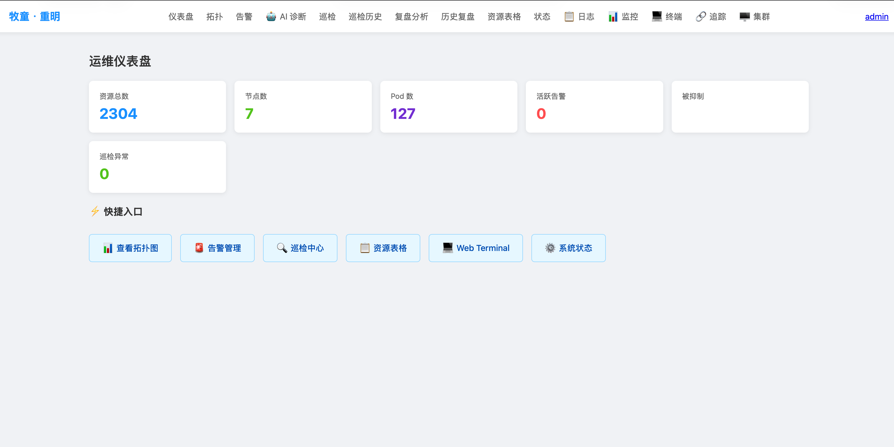
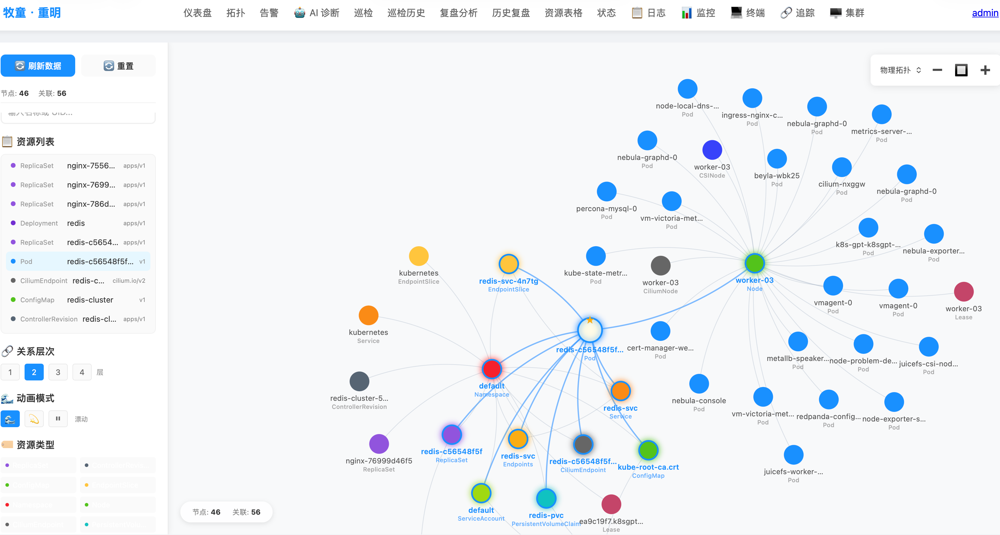
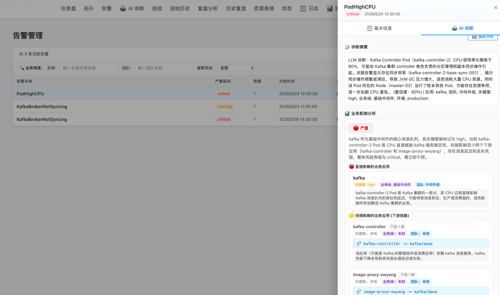
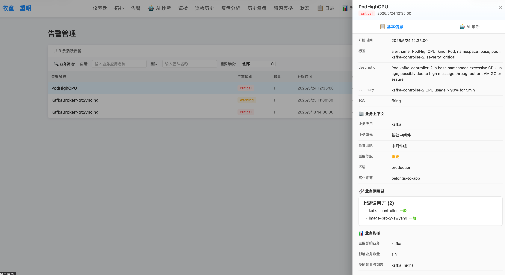
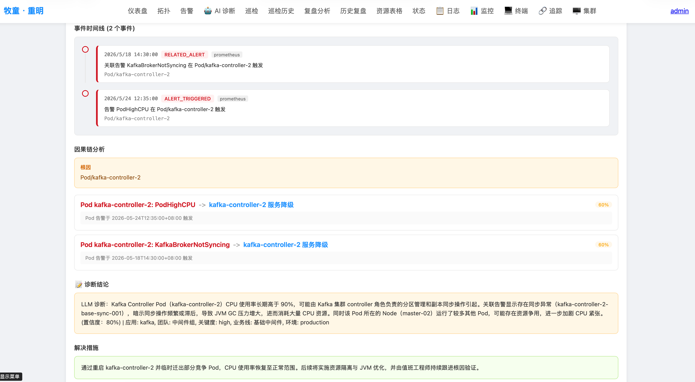

# Mutong (重明)

> 📦 **Open Source Repositories**
> - **GitHub**: [https://github.com/tddh/mutong](https://github.com/tddh/mutong)
> - **Gitee**:  [https://gitee.com/tddh/mutong](https://gitee.com/tddh/mutong)

> This document mirrors [README.md](README.md) (Chinese). Both are kept in sync; the Chinese version is the reference for wording.

## Overview

**Mutong (重明)** is a Kubernetes resource visualization and intelligent operations (AIOps) platform. It automatically collects resources from K8s clusters, builds complete resource topology relationships in a graph database, and provides interactive topology visualization, intelligent alert convergence and diagnosis, declarative inspection, self-healing execution, and post-incident retrospective analysis — all in one platform.

Built on the "**Observe, Understand, Remediate, Learn**" philosophy, Mutong starts from resource visualization, progresses through hybrid AI diagnosis to identify root causes and automatically execute remediation actions, and finally transforms each incident into structured, searchable knowledge assets — forming a complete operations loop.

### Name Origin

> **离，丽也。日月丽乎天，百谷草木丽乎土，重明以丽乎正，乃化成天下。** — *I Ching, Li Hexagram, Tuan Zhuan* (离卦·彖传)

### Core Values

- **Resource Visualization**: Stores K8s resource topology in NebulaGraph, supports complex relationship queries and interactive topology visualization with three rendering engines (G6 / force-graph / d3), plus multi-dimensional filtering
- **Alert Convergence & Intelligent Diagnosis**: Topology-aware alert suppression and causal chain suppression to eliminate alert storms; hybrid AI diagnosis engine (rule-based fast path + LLM deep analysis) with automatic fallback and multi-dimensional confidence scoring
- **Declarative Inspection**: YAML-based inspection rules with 3 built-in check types (`min_rows` / `field_contains` / `command`), Cron scheduling, historical report comparison and trend analysis
- **Self-Healing Executor**: Risk-graded (Low / Medium / High) remediation actions (Pod eviction/restart/delete, Deployment scaling/rollback, image and resource adjustments, etc.) with manual approval and auto-execution modes; post-execution background readiness verification, automatic rollback of reversible actions on verification failure, and complete audit logging
- **Retrospective Knowledge**: Event timeline + causal chain DAG + LLM postmortem reports + graph-enhanced hybrid retrieval (pgvector semantic + NebulaGraph topology), transforming every incident into reusable, searchable knowledge

### 💡 Why this project / Evolution

Mutong's evolution maps the three stages of Kubernetes operations, each step driven by real-world pain points:

| Phase | Pain Point | Solution |
| :--- | :--- | :--- |
| **🟢 2022 Visualization** | Invisible relationships, unknown blast radius | **NebulaGraph Topology**: K8s resource mapping for cascading impact analysis |
| **🟡 2023 Automation** | Manually typing commands while looking at the map is tiring (and my frontend skills are weak) | **API-First Strategy**: Exposed ops as APIs for the CLI to call |
| **🔴 2025 Intelligence** | Root cause ambiguity, siloed expert knowledge | **LLM Agent Hybrid Diagnosis**: Rule fallback + AI-driven troubleshooting knowledge loop |

> Every feature is forged in production scenarios. See the [full evolution story →](docs/evolution.en.md)

### Screenshots

| Dashboard | Topology | AI Diagnosis |
|:---:|:---:|:---:|
|  |  |  |
| *Resource overview and cluster statistics* | *K8s resource topology visualization* | *Interactive LLM diagnosis* |

| Alerts | Inspection | Retrospective |
|:---:|:---:|:---:|
|  |  |  |
| *Alert list and suppression state* | *Inspection results and history comparison* | *Causal chain DAG and impact assessment* |

## Features

### 1. Resource Collection & Storage

- **Multiple Resource Types**: Pods, Services, Deployments, ConfigMaps, Nodes, StatefulSets, DaemonSets, Ingresses, PVCs and other native K8s resources — plus application services auto-discovered via Beyla eBPF + OTel Collector
- **Graph Database**: NebulaGraph stores resource topology (nodes + edges), with nGQL query support and injection protection
- **Relational Database**: PostgreSQL + pgvector (GORM driver, connection pool 100) for users, roles, audit logs, diagnosis results, postmortems, and vectorized incident knowledge
- **Message Queue**: Kafka (franz-go client) for async message processing with dead letter queue and exponential backoff retry
- **Session Cache**: Redis (go-redis/v9) for diagnosis session caching and session-level result storage
- **In-Memory Cache**: BigCache (v3) for sharded high-performance caching with configurable capacity and cleanup policies
- **Label Filtering**: Exclude specific resources by label (e.g. `app.kubernetes.io/managed-by: Helm`)

### 2. Resource Relationship Analysis & Visualization

- **Topology Construction**: Automatically identifies and builds Pod-Deployment, Service-Pod, Node-Pod, Ingress-Service and other multi-dimensional relationships
- **Complex Query Search**: nGQL-based resource search and multi-level relationship queries
- **Web Topology Rendering**: Three engines — @antv/g6 (2D interactive topology), force-graph (3D force-directed), d3 (custom SVG layout)
- **Multi-Dimensional Filtering**: Combine namespace, resource type, label, and fuzzy name matching

### 3. Alert Convergence & Intelligent Diagnosis

- **Topology-Aware Suppression**: Auto-suppresses derived alerts within the same topology scope
- **Causal Chain Suppression**: Identifies causal relationships between alerts (e.g. a Kafka failure suppresses upstream Consumer timeouts), eliminating alert storms
- **Declarative Suppression Rules**: YAML-configured rules that suppress precisely by topology scope (`same_node` / `calls_app_upstream` / `same_owner`)
- **Owner / Stakeholder Dual Routing**: Middleware alerts notify both the responsible party (PagerDuty) and all affected business stakeholders (Slack)
- **Hybrid AI Diagnosis Engine**:
  - Multi-dimensional auto-confidence scoring: rule diagnosis score + related alerts + business criticality; returns directly when the score is high enough
  - LLM deep analysis: Eino ADK Runner (cloudwego/eino) ReAct Agent with all MCP tools registered (29, including execution-class self-healing proposal tools); the LLM selects tools on demand
  - Fault tolerance: SafeTool middleware keeps tool failures from aborting the run; ModelRetryConfig retries automatically (3 attempts with exponential backoff)
  - End-to-end SSE streaming (`text/event-stream`) with incremental frontend rendering, a floating tool-call panel, and layered timeouts
  - Automatic fallback: seamlessly degrades to rule-only diagnosis when the LLM is unavailable
  - Persistent diagnosis results: root cause, business impact, call chain, metric snapshots, log fragments and topology snapshots are stored in PostgreSQL for later retrospective reuse
- **Three-Layer Impact Assessment**: simple count / layered impact / business impact, automatically correlating affected services and Ingresses
- **Topology Snapshot**: Captures the live topology (nodes + edges) of alert-related resources at diagnosis time to give the AI structured context

### 4. Inspection System

- **Declarative YAML Rules**: each rule consists of `query` (nGQL) + `check` (condition) + `severity` + `suggestion`
- **3 Built-in Check Types**:

  | Type | Description |
  |------|-------------|
  | `min_rows` | Checks whether the query result row count meets a threshold (e.g. ensure replicas ≥ 2) |
  | `field_contains` | Checks whether a field value contains a given substring (e.g. certificate CN contains the expected domain) |
  | `command` | External plugin with a stdin / stdout JSON interface; write custom checks in any language |

- **6 Built-in Rules**: certificate expiry, single point of failure, data silo detection, resource quota monitoring, monitoring blind spot scanning, image auditing
- **Scheduled Execution**: Cron expression scheduling + manual trigger
- **Report Comparison & Trends**: historical report comparison, trend analysis, Pass / Fail / Warn statistics

### 5. Self-Healing Executor

- **Supported Actions** (13 types, snake_case API parameters; enum defined in `models/executor/executor.go`):
  - `restart_pod`: graceful Pod restart (tries the Eviction API first, falls back to Delete)
  - `delete_pod`: delete a Pod (recreated automatically by the Deployment/StatefulSet/DaemonSet controller)
  - `scale_deployment`: scale Deployment replicas (protected by a `maxReplicas` ceiling)
  - `rollout_restart`: rolling restart of a Deployment (triggered via a pod template annotation, equivalent to `kubectl rollout restart`)
  - `create_hpa`: create an HPA (Horizontal Pod Autoscaler)
  - `update_hpa`: update an existing HPA configuration
  - `update_configmap`: update ConfigMap data
  - `update_secret`: update Secret data
  - `update_resource_limits`: adjust container CPU/Memory limits and requests (`cpu_limit` / `memory_limit` / `cpu_request` / `memory_request`)
  - `update_deployment_image`: change a container image
  - `rollout_undo`: roll a Deployment back to a previous revision (equivalent to `kubectl rollout undo`, based on ReplicaSet revision history; a specific revision can be given, 0 = previous)
  - `update_annotations`: patch resource annotations (Deployment only for now)
  - `update_labels`: patch resource labels (Deployment only for now)
- **Risk Levels**: Low / Medium / High
- **Execution Modes**: manual approval (default) / auto mode (based on configured risk thresholds)
- **Post-Execution Verification**: after a successful execution, a background poller checks Deployment rollout completion / new Pod readiness (up to 4 minutes, each poll independently timed out), writes the result back to the audit record, and surfaces a verification badge in the UI (verified / failed-and-rolled-back / failed-needs-human / verifying)
- **Automatic Rollback on Failure**: for reversible actions such as image changes and resource adjustments, a failed verification automatically restores the "last known good version" (`knownGood`, falling back to the pre-change template snapshot) so self-healing cannot become self-harm; other actions are flagged for manual intervention
- **Audit Logging**: operator, timestamp, target resource, action type, result and risk level are all written to PostgreSQL

### 6. Retrospective Analysis

- **Event Timeline**: built from alert fingerprints, with MTTD (Mean Time To Detect) latency annotation
- **Causal Chain Analysis**: automatically infers causal relationships between alerts and visualizes the fault propagation path as a DAG
- **LLM Postmortem Reports**: AI-generated structured reports with lessons learned, improvement items and resolutions; supports the WhatWentWell / WhatWentWrong / ContributingFactors three-part reflection
- **Diagnosis Cache Reuse**: reuses the diagnosis stage's root cause, business impact, call chain, metric snapshots, log fragments and topology snapshot
- **Business Topology Graph**: G6-rendered business call chain — affected business (red) → upstream callers (orange) → downstream dependencies (blue), with fullscreen mode
- **Impact Assessment**: blast radius + a three-layer impact table (direct / indirect / business service impact)
- **Metric Snapshots**: CSS bar charts of the Prometheus metrics captured at diagnosis time (CPU / memory / network / restarts), with customizable PromQL via `resourceProfiles`
- **Key Logs**: collapsible ES log cards color-coded by level — ERROR (red) / WARN (orange) / INFO (blue)
- **Improvement Board**: Prevent / Detect / Mitigate three-column board, each item with ExitCriteria + Owner + DueDate
- **Graph-Enhanced Hybrid Retrieval**: pgvector semantic + NebulaGraph structural dual-path retrieval with fusion ranking, automatically discovering historically similar incidents on the same Deployment / Node
- **Retrospective-Resource Bidirectional Association**: query all historical postmortems by resource UID to trace incident history from the resource's perspective
- **History Page**: standalone list page (filter + detail view + manual correction + Markdown export); regenerating for the same fingerprint overwrites automatically (UPSERT)

### 7. Logs & Metrics

- **Elasticsearch Log Queries**: Pod log retrieval, keyword search, filtering by Error / Warn / Info level
- **Prometheus Metric Queries**: Pod / Node / Deployment level metrics, threshold evaluation, HPA status, time-series queries
- **BigCache Caching**: sharded high-performance in-memory caching of ES log and Prometheus query results

### 8. Web Terminal

- **WebSocket K8s Terminal**: WebSocket-based Kubernetes container terminal sessions
- **Multi-Container Switching**: freely switch between containers within a Pod
- **Session Management**: independent session lifecycle management; K8s exec streams and goroutines are reclaimed when the connection closes
- **Auto-Resize**: terminal resize events are synchronized automatically
- **Namespace admission**: system namespaces (`kube-system` / `kube-public` / `kube-node-lease`) are denied by default, everything else is allowed. The `terminal.allowedNamespaces` config field and the `SetAllowedNamespaces` injection hook exist, but `cmd/main.go` does not wire them yet, so setting it currently changes nothing (see the "Known implementation gaps" section of [docs/PROJECT_ARCHITECTURE.md](docs/PROJECT_ARCHITECTURE.md)). Session open/deny and exec start/end emit audit events, which currently go to the server log only (the audit-store injection is likewise pending)
- **Locally Bundled Frontend**: xterm.js and its addons are bundled locally by Vite — no CDN dependency

### 9. Distributed Tracing

- **OpenTelemetry Integration**: full distributed tracing support
- **SkyWalking Compatibility**: supports SkyWalking OAP as the storage backend
- **Service Dependency Analysis**: visualizes inter-service call relationships

### 10. MCP Tool Server

Implements the Model Context Protocol (MCP) with 22 diagnosis tools + 7 execution-class tools (self-healing proposals) — 29 tools in total that the LLM invokes automatically via Function Calling. AI diagnosis registers all tools (no per-scenario filtering); the LLM selects them on demand following prompt guidance. Every tool call is logged for debugging and tracing.

| Tool | Description |
|------|-------------|
| `query_topology` | Query a resource's topology relationships (up to 2 hops, including upstream/downstream dependencies, service associations and the ownerReferences chain; supports any built-in/CRD Kind and can walk up to an operator/CRD root cause) |
| `get_active_alerts` | Get the current active alert list |
| `get_alert_detail` | Get details of a specific alert |
| `run_diagnosis` | Run the AI diagnosis workflow |
| `inspect_resource` | Check the real-time status of a K8s resource |
| `get_inspection_report` | Get the latest inspection report |
| `list_resources_from_graph` | List resources of a given type from NebulaGraph |
| `list_k8s_resources` | Query resources live from the K8s API (built-in resources use the typed client; any CRD uses the watch-synced informer, with group/version resolved automatically via discovery) |
| `list_resources_from_cache` | Query resources from the local informer cache (built-in + any CRD, second-level freshness, no timeouts; CRD group/version/plural resolved via discovery) |
| `get_resource_metrics` | Get a Prometheus metric snapshot for a resource |
| `query_metric_timeseries` | Query metric time-series data |
| `get_system_health` | Get health status of system components |
| `get_metric_catalog` | Get the catalog of available Prometheus metrics |
| `get_pod_logs` | Get Pod logs (K8s API) |
| `get_pod_logs_es` | Get Pod logs (Elasticsearch) |
| `search_logs` | Full-text keyword log search (ES) |
| `get_error_logs` | Get Error-level logs (ES) |
| `search_similar_cases` | Vector similarity search over historical incident cases |
| `search_knowledge_base` | Search the web for real-time technical information (Tavily, returns an AI summary + article links) |
| `search_github_issues` | Search GitHub Issues for known bugs and fixes |
| `list_alerts` | Simplified active alert list |
| `generate_retrospective` | Generate a postmortem report (conditionally enabled) |

**Execution-class tools (self-healing proposals; an alert fingerprint is mandatory, calls without supporting diagnosis are rejected outright, and pending proposals for the same fingerprint are deduplicated)**:

| Tool | Group | Description |
|------|-------|-------------|
| `restart_pod_safe` | Safe group (auto gate) | Safely restart a Pod (graceful Eviction first, Delete fallback) |
| `rollout_restart` | Safe group (auto gate) | Rolling restart of a Deployment (triggered via template annotation) |
| `scale_deployment` | Safe group (auto gate) | Scale Deployment replicas (protected by `maxReplicas`) |
| `update_deployment_image` | Proposal group (mandatory human approval) | Propose a container image change (post-execution verification, automatic rollback on failure) |
| `adjust_resource_limits` | Proposal group (mandatory human approval) | Propose CPU/memory requests/limits adjustments (post-execution verification, automatic rollback on failure) |
| `delete_pod` | Proposal group (mandatory human approval) | Propose deleting a Pod so the controller recreates it (only for controller-managed Pods) |
| `rollout_undo` | Proposal group (mandatory human approval) | Propose rolling a Deployment back to a previous revision (ReplicaSet revision, specific revision supported) |

> Safe-group calls enter the existing gate (auto mode + diagnosis confidence threshold). Proposal-group tools only create pending-approval records and are **never auto-executed under any circumstances** — a human must approve them in the execution records before they take effect.

### 11. RBAC

- **Three Roles**:
  - `admin`: full permissions (read / write / execute / admin)
  - `operator`: read + execute (cannot modify system configuration)
  - `viewer`: read-only
- **Dashboard-Level Permissions**: different roles get different default dashboard views
- **Authentication Middleware**: BearerTokenMiddleware (Bearer token + session cookie dual mode) + RequireAuthMiddleware (deny by default; only login/webhook/external and other explicitly listed paths are public)

### 12. Business Topology

- **Auto-Discovery**: Beyla eBPF collects inter-application HTTP / gRPC calls → OTel Collector receives them → Kafka transports them → the backend consumes and builds business attribution
- **Call Topology**: automatically builds the inter-application call graph with interactive G6 rendering
- **Business Label Sync**: extracts business attribution (application name, business line, owner, etc.) from K8s labels
- **K8s Resource Association**: maps business applications to concrete K8s workloads (Deployment / StatefulSet / DaemonSet), bridging the business and infrastructure views

### 13. CLI Tool (mutongctl)

`mutongctl` is the platform's command-line tool, offering operations parity with the Web UI for CI/CD pipeline integration, automation scripts and fast on-call troubleshooting.

- **Resource Queries**: `get` / `list` for K8s resource details and lists (Pod / Node / Deployment and 6 resource types)
- **Topology Queries**: `topo` for resource relationships (nodes + edges) with depth search
- **Alert Management**: `alert list` / `alert get` for active alerts and details
- **AI Diagnosis**: `diagnose run` triggers LLM diagnosis in one shot; `diagnose status` shows diagnosis service status
- **Inspection**: `inspect run` triggers inspection; `inspect report` / `list` / `compare` / `trend` for reports
- **Retrospective**: `retro generate` / `list` / `get` / `export` / `search` for the full postmortem workflow
- **Logs & Metrics**: `logs` / `metrics` for log and Prometheus queries
- **System Management**: `cluster` / `system` / `stats` / `exec` for cluster status and executor management
- **Business Topology**: `biz` for business applications and call relationships
- **External Search**: `search github` / `search tavily` for GitHub Issues and web knowledge
- **Configuration**: `config` for multi-environment (context) switching, with a flag > env > config-file authentication chain
- **Authentication**: `auth login` runs the browser OAuth2 authorization code flow (PKCE) and saves the token automatically
- **Smart Output**: four output formats (table / json / yaml / markdown), TTY-adaptive and pipe-friendly
- **Shell Completion**: `completion` supports bash / zsh / fish dynamic completion
- **Agent Integration**: exposed as an OpenCode Skill so AI agents can drive resource queries, alert diagnosis, inspection and retrospectives across the platform

See the [mutongctl usage manual](docs/mutongctl-usage.md) for details.

```bash
# Quick examples
mutongctl auth login                              # Browser authorization code login
mutongctl alert list --severity critical          # List Critical alerts
mutongctl diagnose run --fingerprint <fp>         # One-shot AI diagnosis
mutongctl logs pod nginx -n production --tail 50  # Read Pod logs
mutongctl inspect run && mutongctl inspect report # Run inspection and read the report
mutongctl search github -q "OOMKilled" -r "kubernetes/kubernetes"  # Search GitHub Issues
mutongctl search tavily -q "Pod CrashLoopBackOff troubleshooting"  # Search the web
mutongctl config set server https://mutong.example.com  # Configure the server address
```

## Tech Stack

| Component | Technology | Notes |
|-----------|-----------|-------|
| Backend Language | Go | 1.27 |
| Web Framework | Gin | v1.10, aggregated route registration |
| Graph Database | NebulaGraph | v3 client, stores resource topology |
| Relational Database | PostgreSQL + pgvector | GORM driver, vector semantic + structured hybrid retrieval |
| Message Queue | Kafka (franz-go) | Dead letter queue + exponential backoff retry |
| Cache | BigCache (v3) + Redis (go-redis/v9) | In-memory cache + session cache |
| Logging | Zap + Lumberjack | Structured logs + automatic rotation |
| Monitoring | Prometheus + gops | Metrics exposure + Go runtime diagnostics |
| Tracing | OpenTelemetry + SkyWalking | Distributed tracing |
| AI Framework | Eino (cloudwego/eino) | ReAct Agent + Function Calling |
| LLM | MiniMax M2.5 / OpenAI / Claude | Configurable, with rule-based fallback |
| eBPF | Beyla (Grafana) | Automatic application call discovery |
| Profiling | Pyroscope | Continuous profiling |
| Frontend | Vue 3 + Vite | Multi-page SPA |
| Visualization | @antv/g6 + force-graph + d3 | Topology / DAG / force-directed graphs |
| Package Manager | Bun | Frontend dependency management |
| CLI Framework | Cobra + Viper | Command routing, configuration, shell completion |
| Build | Just (Justfile) | Multi-platform cross-compilation |

## Project Structure

```
mutong/
├── cmd/                         # Application entry points
│   ├── main.go                  #   Web service entry (wiring + routes + middleware)
│   ├── mutongctl/               #   CLI tool (20 command modules)
│   ├── mergebizapp/             #   One-off maintenance command: merge duplicate BusinessApp vertices (-dry-run supported)
│   └── resetadmin/              #   Admin password reset utility
├── config/                      # Configuration loading (viper + struct definitions)
├── configs/                     # Split configuration (with .example templates)
│   ├── config.core.yaml.example  #   Core config (databases, cache, logging)
│   ├── config.alert.yaml.example #   Alert system config
│   ├── config.diagnosis.yaml.example # AI diagnosis config
│   ├── config.inspection.yaml.example # Inspection toggles + Cron
│   ├── config.infra.yaml.example #   Infrastructure (ES/OTel/Executor)
│   ├── config.business.yaml.example # Business topology config
│   ├── config.profiles.yaml.example # Resource profiles (split into profiles/)
│   ├── config.auth.yaml.example   #   Authentication and authorization config
│   ├── config.retrospective.yaml.example # Retrospective auto-trigger config
│   ├── profiles/                  #   Per-resource-type profile files
│   │   ├── pod.yml node.yml deployment.yml service.yml
│   │   ├── statefulset.yml daemonset.yml pvc.yml ingress.yml
│   ├── rules/inspection/          #   Per-rule inspection files
│   │   ├── cert_expiry.yml single_point_failure.yml
│   │   ├── cmdb_data_silo.yml monitoring_blindspot.yml
│   │   ├── resource_quota.yml image_audit.yml
│   └── prompts/                 #   LLM prompt templates
├── controllers/                 # Controller layer (34 Go files: 31 implementation + 3 tests, incl. the oauth2/ subpackage)
├── services/                    # Service layer
│   ├── alert/                   #   Alert pipeline: enricher → suppressor → router → notifier
│   ├── diagnosis/               #   AI diagnosis engine (incl. hybrid retrieval)
│   ├── retrospective/           #   Retrospective analysis service
│   ├── inspection/              #   Inspection service
│   ├── executor/                #   K8s self-healing executor
│   ├── mcp/                     #   MCP tool server
│   ├── logsearch/               #   ES log queries
│   ├── prometheus/              #   Prometheus metric queries
│   ├── terminal/                #   WebSocket terminal
│   ├── trace/                   #   OTel trace queries
│   ├── search/                  #   External search clients (Tavily / GitHub)
│   ├── audit/                   #   Audit logging
│   ├── auth/                    #   Authentication and authorization (OAuth2/Casbin/passwords)
│   ├── prompt/                  #   Prompt template management
│   ├── httpclient/              #   Shared HTTP connection pool factory
│   ├── k8sresource_*.go         #   Core K8s resource services
│   ├── getResource.go           #   Resource retrieval interface
│   ├── query_builder.go         #   nGQL query builder
│   ├── ngql_sanitizer.go        #   nGQL injection protection
│   ├── resource_cache.go        #   Resource cache
│   ├── business_label_syncer.go  #   Business label sync (Kafka consumer)
│   ├── business_topology_service.go  # Business topology query service
│   ├── trace_topology_syncer.go  #   Trace topology sync (SkyWalking)
│   ├── flow_topology_syncer.go   #   L4 network flow topology sync (Beyla)
│   ├── namespace_mapper.go       #   Namespace-to-business mapping
│   ├── user_service.go           #   User service
│   └── role_service.go           #   Role service
├── models/                      # Data models (subpackage per module: alert/audit/diagnosis/executor/inspection/oauth2/retrospective)
├── interfaces/                  # Interface definitions (dependency inversion)
├── pkg/                         # Reusable base libraries
│   ├── ngql/                    #   nGQL string literal sanitizer (injection protection)
│   └── safe/                    #   Goroutine safety wrapper (recover + stack trace)
├── view/                        # Frontend code (Vue 3 + Vite)
│   └── src/                     #   15 functional pages + 2 auth pages + shared components
├── docs/                        # Project documentation
│   ├── PROJECT_ARCHITECTURE.md   # Layered architecture, directory responsibilities, key flows
│   ├── evolution.en.md           # Evolution notes and design thinking (Chinese: evolution.md)
│   ├── mutongctl-usage.md        # CLI quick reference and usage manual
│   ├── ngql.md                   # NebulaGraph schema reference and query examples
│   ├── TODO.md                   # Backlog and competitive gap analysis
│   ├── remediation-plan.md       # Security and release engineering remediation plan
│   └── images/                   # UI screenshots
├── scripts/                     # Script utilities
│   ├── schema.ngql               #   NebulaGraph DDL (run via just init-nebula)
│   ├── init_postgres.sh          #   PostgreSQL initialization
│   ├── update_nebula.sh          #   NebulaGraph update script
│   ├── init_es_template.sh       #   Elasticsearch index template initialization
│   └── smoke_test.sh             #   Smoke tests
├── deploy/                      # Deployment config (Beyla + OTel Collector Helm charts and values, entrypoint.sh)
├── artifacts/                   # Build output directory
├── agent.yaml.example           # SkyWalking agent config template
├── Justfile                     # Build commands
├── Dockerfile                   # Multi-stage build (non-root, HEALTHCHECK /healthz)
├── docker-compose.yml           # One-command local dependencies + app
├── ROADMAP.md                   # Version roadmap
├── CONTRIBUTING.md              # Contribution guide
├── SECURITY.md                  # Security policy and vulnerability reporting
├── go.mod                       # Go module definition (go 1.27.0)
└── LICENSE                      # MIT license
```

See the [project architecture document](docs/PROJECT_ARCHITECTURE.md) for layer responsibilities and key flows.

## Configuration

Configuration lives in the split files under `configs/`, loaded at startup in directory mode via `-c configs/`. All `config.*.yaml` files in the directory are merged in alphabetical order, so their top-level YAML keys must not overlap.

Every config file ships an `.example` template. **Copy them to real config files before first use**:

```bash
for f in configs/*.yaml.example; do cp "$f" "${f%.example}"; done
cp agent.yaml.example agent.yaml
```

### Core Configuration (config.core.yaml)

```yaml
kubernetes:
  clusters:
    - name: "cluster1"
      config: kubeconfig

postgres:
  host: localhost
  port: 5432
  user: mutong
  pass: "your-password"
  database: mutong
  pool: 100

nebula:
  host: "localhost"
  port: 9669
  user: "root"
  pass: "nebula"
  space: "mutong"

cache:
  lifeTime: 40
  cleanWindow: 10
  enable: true
  hardMaxCacheSize: 4096
  shards: 256

log:
  level: info
  path: logs
  max_size: 100
  max_age: 30

server:
  address: "0.0.0.0"
  port: 8888
  rateLimitPerSec: 100
  enableSwagger: false     # Swagger UI is off by default; it exposes the full API surface
  sseWriteTimeoutSec: 300  # SSE write timeout for long-lived connections such as diagnosis chat
```

### Alert Configuration (config.alert.yaml)

```yaml
alert:
  routing:
    defaultReceiver: "default"
    defaultChannel: "slack"
  notifier:
    slackWebhookUrl: ""
    emailConfig: {}
  suppressor:
    timeWindowSeconds: 300
    maxDepth: 3
  cleanup:
    cleanupInterval: 1
    retentionDuration: 4320  # half a year

# External alert source registration (Ceph/Kafka/MySQL or any other system)
# labelMapping maps external labels to the internal standard format
# enrichmentStrategy selects the bridging strategy: node_affinity / service_graph / direct_business_app / business_labels / none
alertSources:
  sources:
    - name: "ceph-prod"
      type: "ceph"
      enrichmentStrategy: "node_affinity"
      labelMapping:
        alertname: "alert_name"
        node: "host"
      businessMapping:
        team: "storage-team"
```

### Diagnosis Configuration (config.diagnosis.yaml)

```yaml
diagnosis:
  enabled: true
  confidenceThreshold: 0.8
  cacheTTL: 3600
  llm:
    provider: "openai"    # none / openai / claude / custom
    model: "gpt-4"
    apiKey: ""            # set via the MUTONG_LLM_API_KEY environment variable
    baseURL: "https://api.openai.com"
    timeout: 120
    maxTokens: 16384      # maximum output tokens per LLM call
    embedding:
      model: "text-embedding-3-small"
      baseURL: "https://api.openai.com"
  session:
    enabled: true
    redis: "localhost:6379"
    password: ""         # always set in production, via MUTONG_REDIS_PASSWORD
    db: 9
    ttl: 1800            # Redis session TTL (seconds); PG keeps 30 days with automatic cleanup

# External knowledge base search
external_search:
  enabled: true
  auditEnabled: true
  tavily:
    apiKey: ""  # set via the MUTONG_TAVILY_KEY environment variable
    timeoutSeconds: 15
    maxResults: 3
  github:
    token: ""  # set via MUTONG_GITHUB_TOKEN (optional; without a token the limit is 60 requests/hour)
    timeoutSeconds: 10
    maxResults: 3
```

### Self-Healing Executor Configuration (config.infra.yaml)

```yaml
executor:
  enabled: false
  autoMode: false
  auditLog:
    type: postgres
    table: executor_audit_logs
  actions:
    restart_pod:
      risk: low
      autoThreshold: 0.7
    scale_deployment:
      risk: medium
      autoThreshold: 0.85
    delete_pod:
      risk: high
      autoThreshold: 1.0
    rollout_restart:
      risk: low
      autoThreshold: 0.7
    rollout_undo:
      risk: high
      autoThreshold: 1.0
    create_hpa:
      risk: medium
      autoThreshold: 0.9
    update_hpa:
      risk: medium
      autoThreshold: 0.85
    update_configmap:
      risk: medium
      autoThreshold: 0.9
    update_secret:
      risk: high
      autoThreshold: 0.95
    update_resource_limits:
      risk: medium
      autoThreshold: 0.85
    update_deployment_image:
      risk: high
      autoThreshold: 0.9
    update_annotations:
      risk: low
      autoThreshold: 0.7
    update_labels:
      risk: low
      autoThreshold: 0.7
```

### Environment Variables

The following environment variables override the corresponding config file fields (read in `cmd/main.go` and `config/config.go`):

| Variable | Description | Default |
|----------|-------------|---------|
| `MUTONG_ADDR` | HTTP listen address, overrides `server.address` | From config file (0.0.0.0) |
| `MUTONG_PORT` | HTTP port, overrides `server.port` | From config file (8888) |
| `MUTONG_MAX_PROCS` | GOMAXPROCS | Number of CPU cores |
| `MUTONG_ALLOWED_ORIGINS` | Comma-separated CORS origins; `*` is ignored | Empty (cross-origin denied) |
| `MUTONG_DB_USER` | PostgreSQL username | - |
| `MUTONG_DB_PASSWORD` | PostgreSQL password | - |
| `MUTONG_NEBULA_USER` | Nebula username | - |
| `MUTONG_NEBULA_PASS` | Nebula password | - |
| `MUTONG_LLM_API_KEY` | LLM API key | - |
| `MUTONG_EMBEDDING_API_KEY` | Embedding API key (falls back to the LLM key when unset) | - |
| `MUTONG_REDIS_ADDR` | Redis address | - |
| `MUTONG_REDIS_PASSWORD` | Redis password | - |
| `MUTONG_REDIS_DB` | Redis database index | - |
| `MUTONG_TAVILY_KEY` | Tavily external search API key | - |
| `MUTONG_GITHUB_TOKEN` | GitHub Issues search token (optional) | - |
| `MUTONG_INIT_ADMIN_PASSWORD` | Password used to create the `admin` account on first start; never resets an existing account | Admin account is not created when unset |
| `MUTONG_ISSUER_URL` | OAuth2 / OIDC issuer URL | - |

Security-related variables (`MUTONG_SESSION_SECRET`, `MUTONG_ADMIN_KEY`, `MUTONG_WEBHOOK_SECRET`, `MUTONG_TRUSTED_PROXIES`, etc.) are documented in [Security Configuration](#security-configuration) below.

## Installation & Running

### Prerequisites

#### Required Components (the process will not start without them)

| Component | Version | Purpose | Install |
|-----------|---------|---------|---------|
| Go | 1.27 | Backend build and run (`go.mod` declares `go 1.27.0`) | [go.dev/dl](https://go.dev/dl/) |
| Bun | 1.x+ | Frontend package management | [bun.sh](https://bun.sh/) |
| NebulaGraph | 3.8+ | Graph database — stores K8s resource topology | [nebula-graph.io](https://www.nebula-graph.io/download) |
| Kafka (or Redpanda) | Kafka 2.x+ / Redpanda v24+ | Message queue — async transport of K8s resource change events | [kafka.apache.org](https://kafka.apache.org/downloads) |
| BigCache | Embedded, auto-initialized | In-memory cache — high-performance sharded caching | — |

> ⚠️ **NebulaGraph and Kafka are hard dependencies**; a connection failure exits the process. Without PostgreSQL the service can start in degraded mode, but most persistence features are unavailable (see the degradation notes below).

#### Optional Components (enabled on demand; the corresponding feature degrades when absent)

| Component | Version | Purpose | Behavior when absent |
|-----------|---------|---------|----------------------|
| PostgreSQL | 15+ (with pgvector) | Relational data & vector retrieval | ⚠️ Degrades to in-memory storage: users/roles/alert statistics/diagnosis results/postmortems are not persisted and vector semantic search is unavailable |
| Kubernetes cluster | — | Resource collection & self-healing | ⚠️ K8s features (topology visualization, terminal, self-healing) are unavailable; the platform still processes alerts and diagnosis |
| Redis | 7+ | Diagnosis session cache & login rate limiting | ⚠️ Diagnosis sessions degrade to in-memory mode (lost on restart); login rate limiting is unavailable |
| Prometheus | 2.x+ | Metric queries (CPU/memory/network/restarts) | ⚠️ Metric query APIs return 503; diagnosis results contain no metric snapshots |
| Elasticsearch | 8.x+ | Log search | ⚠️ ES log queries are unavailable; direct K8s API log reads still work |
| LLM API Key | — | AI diagnosis deep analysis & postmortem generation | ⚠️ Diagnosis automatically degrades to the rule-only path (rule engine + topology analysis) and still produces confidence scores |
| Beyla + OTel Collector | Beyla 2.x+ | eBPF auto-discovery of service calls → business topology | ⚠️ Business topology and call graphs are unavailable |
| SkyWalking OAP | 9.x+ | Distributed tracing backend | ⚠️ Distributed trace queries are unavailable |
| Pyroscope | — | Continuous profiling | ⚠️ Profiling flame graphs are unavailable |

> 💡 **Minimal startup**: NebulaGraph + Kafka + Go/Bun are enough to build and run. Configure those two components in `configs/config.core.yaml` to start the process, then add other components incrementally — each one enables a class of features.

### Quick Start

```bash
# 1. Clone
git clone https://gitee.com/tddh/mutong.git
cd mutong

# 2. Initialize configuration (copy from the .example templates)
for f in configs/*.yaml.example; do cp "$f" "${f%.example}"; done
cp agent.yaml.example agent.yaml
# Edit database connections, K8s clusters, etc. in configs/*.yaml

# 3. Inject secrets (mandatory for production; see "Security Configuration")
export MUTONG_SESSION_SECRET="$(openssl rand -hex 32)"
export MUTONG_WEBHOOK_SECRET="$(openssl rand -hex 32)"
export MUTONG_INIT_ADMIN_PASSWORD='<strong password>'

# 4. Initialize databases
just init-nebula
# Run scripts/init_postgres.sh to initialize the PostgreSQL schema

# 5. Build & run
just build-mac       # Produces the darwin binary (macOS local development)
just run             # Picks the host-platform binary under artifacts/ and starts with -c configs/

# Debug mode
just run-debug
```

> `just run` / `just run-debug` / `just run-config` select `artifacts/mutong-<os>-<arch>` for the host platform. Use `just build-mac` on macOS (Apple Silicon), `just build` on Linux x86_64, and `just build-host` on any other platform. `just build` only compiles and syncs configuration — it no longer embeds `go mod tidy` / `gofmt`; run `just tidy` and `just fmt` explicitly when you need them.

### Docker Deployment

> **Prerequisites**: Docker Engine 20.10+ and Docker Compose v2+

All database passwords in the root `docker-compose.yml` are required variables — `docker compose` fails fast instead of falling back to weak defaults:

```bash
export POSTGRES_PASSWORD='<database password>'
export NEBULA_PASSWORD='<Nebula password>'
export MUTONG_REDIS_PASSWORD='<Redis password>'
# Application-side secrets (see "Security Configuration")
export MUTONG_SESSION_SECRET="$(openssl rand -hex 32)"
export MUTONG_WEBHOOK_SECRET="$(openssl rand -hex 32)"

docker compose up -d
```

This starts the following services (Redpanda replaces Apache Kafka and is Kafka-protocol compatible):

| Service | Image | Purpose |
|---------|-------|---------|
| PostgreSQL 16 + pgvector | `pgvector/pgvector:pg16` | Relational data & vector retrieval |
| NebulaGraph metad | `vesoft/nebula-metad:v3.8.0` | Graph database metadata service |
| NebulaGraph storaged | `vesoft/nebula-storaged:v3.8.0` | Graph database storage service |
| NebulaGraph graphd | `vesoft/nebula-graphd:v3.8.0` | Graph database query service (9669) |
| Redpanda (Kafka compatible) | `vectorized/redpanda:v24.2.5` | Message queue (9092) |
| Redis | `redis:7-alpine` | Session cache (6379) |
| Mutong | Built locally | Main application (8888) |

All three NebulaGraph components are required: graphd alone cannot create a space without metad/storaged, and `just init-nebula` would fail. Service ports are published to the host for local debugging; tighten the exposed surface for production.

See `docker-compose.yml` for details. Before deploying to production, change every default password and confirm the image contains only `*.example` config templates (see `.dockerignore`).

### Deploying Business Topology Components

Business topology requires Beyla (eBPF) + OTel Collector to collect inter-service calls automatically.

**Data flow**: `Beyla (eBPF collection) → OTel Collector (OTLP intake) → Kafka (mutong_trace_01) → Mutong (TraceTopologySyncer + BusinessLabelSyncer)`

```bash
# Online installation
helm repo add grafana https://grafana.github.io/helm-charts
helm repo add open-telemetry https://open-telemetry.github.io/opentelemetry-helm-charts
helm repo update
helm install beyla grafana/beyla -n beyla --create-namespace -f deploy/helm-beyla-values.yaml
helm install otel-collector open-telemetry/opentelemetry-collector -n otel-collector --create-namespace -f deploy/helm-otelcol-values.yaml

# Verify
kubectl get pods -n beyla
kubectl get pods -n otel-collector
kubectl logs -n otel-collector -l app.kubernetes.io/name=opentelemetry-collector --tail=50
```

Air-gapped environments: `helm pull` the charts → transfer the `.tgz` files and the values files under `deploy/` → `helm install` locally.

### Frontend Development

```bash
cd view && bun install    # Install dependencies
just dev-ui               # Dev mode (hot reload)
just build-ui             # Production build
```

Vite dev proxy configuration (applied automatically by `just dev-ui`):

| Proxy Path | Target |
|------------|--------|
| `/api/*` | `http://localhost:8888` |
| `/k8s/*` | `http://localhost:8888` |
| `/metrics/*` | `http://localhost:8888` |

## API Overview

### K8s Resource API

| Method | Path | Description |
|--------|------|-------------|
| GET | `/api/v1/k8s/resources/{name}` | Get details of a specific resource |
| GET | `/api/v1/k8s/resources/graph/nodes` | Get all resource nodes |
| GET | `/api/v1/k8s/resources/graph/edges` | Get all resource relationships |
| GET | `/api/v1/k8s/resources/graph/metadata` | Get resource type and namespace metadata |
| GET | `/api/v1/k8s/resources/graph/search` | Search resource relationships |
| GET | `/api/v1/k8s/resources/graph/resource-define` | Get resource type definitions |
| GET | `/api/v1/k8s/resources/graph/suggest` | Resource search autocomplete suggestions |

### Alert Management API

| Method | Path | Description |
|--------|------|-------------|
| POST | `/api/v1/alerts/webhook` | Receive Alertmanager webhooks (K8s alerts); signature required |
| POST | `/api/v1/alerts/external/:source` | Receive external system alerts (Ceph/Kafka/MySQL, etc.); token or trusted IP required |
| GET | `/api/v1/alerts` | Get the active alert list |
| GET | `/api/v1/alerts/{fingerprint}` | Get alert details |
| GET | `/api/v1/alerts/health` | Alert service health check |
| GET | `/api/v1/alerts/suppression/status` | Get current suppression status |
| GET | `/api/v1/alerts/sources` | List all registered external alert sources |

### AI Diagnosis API

| Method | Path | Description |
|--------|------|-------------|
| POST | `/api/v1/diagnosis/run` | Run AI diagnosis |
| POST | `/api/v1/diagnosis/rerun` | Re-run diagnosis |
| GET | `/api/v1/diagnosis/result/{id}` | Get a diagnosis result |
| GET | `/api/v1/diagnosis/status` | Diagnosis service status |
| GET | `/api/v1/diagnosis/tools` | List all MCP tools |
| POST | `/api/v1/diagnosis/mcp/tool/{name}` | Execute a specific MCP tool |
| POST | `/api/v1/diagnosis/chat/ask` | AI diagnosis chat (SSE streaming, auto-creates session history) |
| POST | `/api/v1/diagnosis/chat/context` | Establish diagnosis context |
| GET | `/api/v1/diagnosis/chat/sessions` | Current user's session history list |
| GET | `/api/v1/diagnosis/chat/sessions/{id}` | Load a specific session |
| DELETE | `/api/v1/diagnosis/chat/sessions/{id}` | Delete a specific session |
| GET | `/api/v1/diagnosis/chat/session/by-alert` | Look up a session by alert fingerprint |
| DELETE | `/api/v1/diagnosis/chat/{sessionId}` | Close a session |

### Inspection API

| Method | Path | Description |
|--------|------|-------------|
| POST | `/api/v1/inspection/execute` | Manually trigger inspection |
| GET | `/api/v1/inspection/report` | Get the latest inspection report |
| GET | `/api/v1/inspection/reports` | Historical report list |
| GET | `/api/v1/inspection/reports/{id}` | Specific report details |
| GET | `/api/v1/inspection/reports/{id}/compare/{other_id}` | Compare two reports |
| GET | `/api/v1/inspection/trend` | Inspection trend data |
| GET | `/api/v1/inspection/rules` | Custom rule list |
| POST | `/api/v1/inspection/rules` | Create a custom inspection rule |
| PUT | `/api/v1/inspection/rules/{id}` | Update an inspection rule |
| DELETE | `/api/v1/inspection/rules/{id}` | Delete an inspection rule |
| POST | `/api/v1/inspection/rules/{id}/toggle` | Enable/disable an inspection rule |

### Self-Healing Executor API

| Method | Path | Description |
|--------|------|-------------|
| GET | `/api/v1/executor/status` | Executor status |
| GET | `/api/v1/executor/audit` | Audit log list |
| POST | `/api/v1/executor/execute` | Execute a remediation action |
| POST | `/api/v1/executor/toggle` | Toggle auto / manual mode |
| POST | `/api/v1/executor/diagnose-and-execute` | Diagnose and execute automatically |
| POST | `/api/v1/executor/audit/{id}/approve` | Approve a pending execution plan and run it immediately (admin gate required) |

### Log Query API

| Method | Path | Description |
|--------|------|-------------|
| GET | `/api/v1/logs/pod` | Get Pod logs (ES) |
| GET | `/api/v1/logs/search` | Keyword log search |
| GET | `/api/v1/logs/errors` | Get Error-level logs |
| GET | `/api/v1/logs/warn` | Get Warn-level logs |
| GET | `/api/v1/logs/info` | Get Info-level logs |

### Metrics & Monitoring API

| Method | Path | Description |
|--------|------|-------------|
| GET | `/api/v1/metrics/pod` | Pod metrics |
| GET | `/api/v1/metrics/node` | Node metrics |
| GET | `/api/v1/metrics/deployment` | Deployment metrics |
| GET | `/api/v1/metrics/statefulset` | StatefulSet metrics |
| GET | `/api/v1/metrics/daemonset` | DaemonSet metrics |
| GET | `/api/v1/metrics/service` | Service metrics |
| GET | `/api/v1/monitoring/metrics/{resourceType}` | Metrics by resource type |
| GET | `/api/v1/monitoring/timeseries` | Metric time-series data |
| GET | `/api/v1/monitoring/health` | System health status |
| GET | `/api/v1/monitoring/catalog` | Available metric catalog |

### Retrospective API

| Method | Path | Description |
|--------|------|-------------|
| GET | `/api/v1/retrospective/timeline/{fingerprint}` | Event timeline |
| GET | `/api/v1/retrospective/causal-chain/{fingerprint}` | Causal chain analysis |
| POST | `/api/v1/retrospective/postmortem/{fingerprint}` | Generate a postmortem report |
| PUT | `/api/v1/retrospective/postmortem/{fingerprint}` | Manually correct a report |
| GET | `/api/v1/retrospective/postmortem/{fingerprint}/text` | Export Markdown |
| GET | `/api/v1/retrospective/list` | Paginated historical report list |
| GET | `/api/v1/retrospective/history/{fingerprint}` | Historical report details |
| GET | `/api/v1/retrospective/knowledge/search` | Graph-enhanced hybrid incident knowledge search |
| GET | `/api/v1/retrospective/resource/{resourceUID}/postmortems` | Historical postmortems by resource |

### User & Role API

| Method | Path | Description |
|--------|------|-------------|
| GET | `/api/v1/users` | Get user information |
| GET | `/api/v1/roles` | Get role information |

### Authentication API

| Method | Path | Description |
|--------|------|-------------|
| POST | `/api/auth/login` | User login (password) |
| GET | `/api/auth/me` | Get the current logged-in user |
| POST | `/api/auth/logout` | User logout |
| POST | `/api/auth/tokens` | Create an API token (PAT) |
| GET | `/api/auth/tokens` | List the current user's API tokens |
| DELETE | `/api/auth/tokens/:id` | Revoke a specific API token |

### OAuth2 / OIDC API

| Method | Path | Description |
|--------|------|-------------|
| GET/POST | `/oauth2/authorize` | OAuth2 authorization endpoint |
| POST | `/oauth2/token` | OAuth2 token endpoint (Authorization Code + PKCE, Refresh Token, Client Credentials, Device Code; alias `POST /oauth/v2/token`) |
| POST | `/oauth2/introspect` | Token introspection endpoint |
| POST | `/oauth2/revoke` | Token revocation endpoint |
| POST | `/oauth2/device/auth` | Device authorization request (RFC 8628; alias `POST /oauth/v2/device_authorization`). Returns `device_code`, an 8-character `user_code` and `verification_uri`; expires in 600s, polling interval 5s |
| GET/POST | `/device` | Device authorization confirmation page (login required; approval binds the grant to the approving user) |
| GET | `/.well-known/openid-configuration` | OIDC discovery metadata |

> **Current device-flow token behavior**: the client polls `/oauth2/token` with `grant_type=urn:ietf:params:oauth:grant-type:device_code`. The `client_id` must match the one that started the authorization, and the device code is consumed atomically exactly once (`authorized → completed`). On success the endpoint **issues a real persisted PAT** (`mtp_` prefix, bound to the approving user and the granted scope, valid for 1 day / `expires_in=86400`) that goes through the same validation and revocation path as every other token. **No `refresh_token` is returned.** `verification_uri` comes from `MUTONG_ISSUER_URL`, never from the request's Origin header.

### Other API

| Method | Path | Description |
|--------|------|-------------|
| GET | `/api/v1/clusters` | Cluster list |
| GET | `/api/v1/clusters/{name}/health` | Cluster health check |
| GET | `/api/v1/clusters/{name}/stats` | Cluster statistics |
| GET | `/api/v1/stats/overview` | Resource overview statistics |
| GET | `/api/v1/stats/resource-total` | Total resource count statistics |
| POST | `/api/v1/stats/sync` | Manually sync resources |
| GET | `/api/v1/terminal/ws` | WebSocket terminal connection |
| GET | `/api/v1/terminal/namespaces` | List namespaces |
| GET | `/api/v1/terminal/pods` | List Pods |
| GET | `/api/v1/terminal/containers` | List containers |
| GET | `/api/v1/trace/query` | Query traces |
| GET | `/api/v1/trace/services` | Service list |
| GET | `/api/v1/trace/spans` | Span details |
| GET | `/api/v1/business-topology/apps` | Business application list |
| GET | `/api/v1/business-topology/graph` | Business topology graph data |
| GET | `/api/v1/business-topology/calls` | Inter-application call relationships |
| GET | `/api/v1/system/status` | Overall system status |
| GET | `/healthz` | Unauthenticated liveness probe, returns `200 ok` (for K8s / Docker health checks) |
| GET | `/metrics` | Prometheus metrics endpoint (authenticated by default; `MUTONG_METRICS_PUBLIC=true` makes it public) |

## Frontend Pages

15 functional pages, all responsive, each carrying the same sticky **NavBar**. Navigation is **data-driven**, with a single source of truth in `view/src/components/nav.config.js`:

- **`NAV_ITEMS` (12 visible entries)**: 8 primary entries + 4 secondary entries collapsed into a "More" menu (laying all 12 out flat overflows at 1280px)
  > Primary: Dashboard | Topology | Alerts | AI Diagnosis | Inspection | Status | Terminal | Clusters
  > More: Inspection History | Retrospective | Retrospective History | Resource Table
- **`NAV_HIDDEN` (3 collapsed entries)**: Logs / Monitoring / Trace. **The page code is fully retained**; each entry records why it was hidden and where the code lives. Restoring one only requires moving it back into `NAV_ITEMS` with a `group` — no template changes.

  | Entry | Why it is hidden |
  |-------|------------------|
  | Logs | Depends on Elasticsearch; `localhost:9200` is not listening in the test environment. The client does not probe connectivity, so the routes exist but every query fails |
  | Monitoring | The page is too crude; it will be rebuilt as an embedded Grafana view (see `docs/TODO.md`) |
  | Trace | `opentelemetry.enabled=false` in `config.infra.yaml`, so TraceController is not mounted |

> Earlier versions hid entries by wrapping them in comment blocks inside the NavBar template. Comments survive in dev mode but are dropped by production builds, so behavior was inconsistent. With the data-driven approach, hidden entries live explicitly in `NAV_HIDDEN` and no longer depend on comment semantics.

In addition to those 15 functional pages there are 2 authentication pages — `login.html` (platform login) and `consent.html` (OAuth consent) — which do not use the global NavBar.

The table below lists all 15 functional pages, including the 3 that currently have no menu entry:

| Page | Entry | Description |
|------|-------|-------------|
| Dashboard | `view/src/index.html` | StatCards with 6 core metrics (total resources / nodes / Pods / active alerts / suppressed alerts / inspection anomalies) + quick links; failed requests render an error state instead of falling back to fake data |
| Topology | `view/src/topology/index.html` | force-graph force-directed layout, physical/business dual view, left filter sidebar, right detail panel (metric badges / related resources) |
| Resource List | `view/src/resource-table.html` | Paginated table (500/page), colored by Kind, keyword search (300ms debounce) + Terminal jump |
| Alert Management | `view/src/alerts/index.html` | Expand/collapse aggregated alerts, filter by business app/team/criticality, right drawer with two tabs (basic info + AI diagnosis) |
| AI Diagnosis | `view/src/diagnosis/index.html` | Conversational Markdown streaming (30ms incremental buffer), floating tool-call panel (pulse animation + auto-dismiss), sidebar session history with LLM-generated titles, new/resume/delete sessions, layered timeouts (300s total / 15s first token / 60s idle), retry on stream interruption |
| Inspection Report | `view/src/inspection/index.html` | Manual trigger, table of per-rule results (level/rule/resource/suggestion), 6 built-in rules |
| Inspection History | `view/src/inspection-history/index.html` | Historical report filtering, detail view, report comparison, trend analysis (7/14/30/60/90 days) |
| Retrospective | `view/src/retrospective/index.html` | Generate a postmortem by fingerprint: event timeline + causal DAG + business topology + impact assessment + metric snapshots + key logs + improvement board |
| Retrospective History | `view/src/retrospective-history/index.html` | Historical report filtering, detail view, manual correction (UPSERT), Markdown export |
| Logs | `view/src/logs/index.html` | ES log search with 7 filters (namespace/pod/container/level/keyword/since/tail), colored by level (menu entry hidden) |
| Monitoring | `view/src/monitoring/index.html` | Left resource selector → right metric card grid (CPU/memory/network/restarts), 8 Prometheus metric types (menu entry hidden) |
| Web Terminal | `view/src/terminal/index.html` | xterm.js 5.5 (bundled locally), 5-step connection flow, auto-resize, URL parameter prefill |
| Trace | `view/src/trace/index.html` | SkyWalking, query by service/operation/TraceID, span waterfall view (menu entry hidden) |
| Clusters | `view/src/clusters/index.html` | Cluster list + health check + statistics modal, 30s auto-refresh |
| System Status | `view/src/status/index.html` | 5 status cards (LLM / suppression / processing metrics / diagnosis statistics / self-healing executor), 30s auto-refresh |

## Build Commands

Build workflow is managed with `just`:

| Command | Description |
|---------|-------------|
| `just build` | Build Linux amd64 + macOS arm64 binaries (does not rewrite go.mod or format code) |
| `just build-host` | Build only the host-platform binary (the artifact `just run` uses) |
| `just build-mac` | Build macOS arm64 only (local development) |
| `just build-skywalking` | Build with the SkyWalking agent (Linux amd64 + arm64) |
| `just run` | Run the host-platform artifact (`-c configs/` directory mode) |
| `just run-debug` | Run in debug mode (log-level=debug) |
| `just run-config <file>` | Run with a specific config file |
| `just dev-ui` | Frontend dev mode (hot reload) |
| `just build-ui` | Build the frontend (output to artifacts/view) |
| `just preview-ui` | Frontend preview |
| `just test` | Run all unit tests (-race) |
| `just test-cover` | Run tests and generate a coverage report |
| `just test-module <module>` | Run tests for a specific module |
| `just test-alert` | Run alert system API tests |
| `just test-ui` | Frontend tests (vitest) |
| `just bench` | Benchmarks |
| `just smoke-test` | Run dynamic smoke tests |
| `just init-nebula` | Initialize the NebulaGraph space and schema |
| `just update-nebula` | Update nGQL statements |
| `just init-es-template` | Initialize Elasticsearch index templates |
| `just clean` | Clean build artifacts |
| `just fmt` | Format Go code (gofmt) |
| `just tidy` | Tidy dependencies (go mod tidy, independent of build) |
| `just lint` | Static analysis (go vet) |
| `just swagger` | Generate Swagger API docs |
| `just all` | One-shot flow: fmt + test + build |
| `just full-build` | Full backend + frontend build |
| `just build-cli` | Build mutongctl (linux amd64 + darwin arm64) and sync the OpenCode Skill |
| `just build-cli-mac` | Build the macOS arm64 mutongctl only |
| `just test-cli` | Run CLI unit tests |
| `just all-cli` | CLI tests + build |
| `just run-js` | Run JavaScript test files |

## Development Guide

### Adding a New Resource Relationship Type

1. Add the new edge type DDL to `scripts/schema.ngql` and update the schema overview table in `docs/ngql.md`
2. Run `just init-nebula` to apply the schema change
3. Implement relationship detection in `services/k8sresource_relationships.go`
4. Update the nGQL query builder in `services/query_builder.go`
5. Add the corresponding API endpoint in `controllers/k8sresource_controller.go`
6. Update the legend and rendering configuration in `view/src/topology/`

### Adding a New Inspection Rule

No Go changes needed — create `<rule_name>.yml` under `configs/rules/inspection/`:

```yaml
name: "check-pod-restarts"
description: "Check Pod restart counts"
query: |
  MATCH (p:K8sResource{kind:'Pod', is_deleted:false})
  RETURN p.K8sResource.name AS name, p.K8sResource.name_space AS namespace
check:
  type: min_rows
  threshold: 3
severity: "warning"
suggestion: "Pods are restarting frequently; check resource limits and application logs"
```

If the built-in check types are not enough, write a `command` plugin script (JSON parameters on stdin, JSON result on stdout) and place it in `/etc/mutong/plugins/`.

### Code Style

- **Formatting**: `gofmt -w .`
- **Naming**: CamelCase; exported identifiers start with an uppercase letter
- **Comments**: all exported functions, types and constants must have doc comments
- **Error handling**: handle every error explicitly and log structured fields with `zap`
- **Static analysis**: `just lint` (go vet) must pass before committing

## Troubleshooting

### Startup & Connectivity

**Q: Startup fails with `cannot connect to NebulaGraph`**  
Check that NebulaGraph is running (`nebula-console -addr localhost -port 9669 -u root -p nebula`) and that `nebula.host` / `nebula.port` in `configs/config.core.yaml` are correct. When running via Docker Compose, make sure metad and storaged are up too — graphd alone cannot serve queries.

**Q: No data on the topology page**  
Check that Kafka is running and that the broker and topic settings in `configs/config.infra.yaml` are correct. The initial informer sync takes 1-2 minutes.

**Q: Cluster status shows "unknown"**  
Check that the kubeconfig path is valid and that `kubernetes.config` in `configs/config.core.yaml` points to a working kubeconfig.

### AI Diagnosis

**Q: AI diagnosis is unavailable / LLM not connected**  
Check the LLM settings in `configs/config.diagnosis.yaml`: `provider` must not be `none`, `apiKey` must be set, and `baseURL` must be reachable. Prefer setting the key via `MUTONG_LLM_API_KEY`.

**Q: Diagnosis answers are too short or get cut off**  
Check `maxTokens` in `configs/config.diagnosis.yaml`. The DeepSeek API accepts `[1, 393216]`; `16384` or higher is recommended. If the response ends with an "interrupted" notice, check network stability or raise the frontend idle timeout.

**Q: Semantic search (hybrid retrieval) does not work**  
Make sure `embedding.model` is configured in `configs/config.diagnosis.yaml` and that the embedding endpoint serves `/v1/embeddings`. Without embedding configuration the graph-structure search path still works.

### Logs & Metrics

**Q: No Prometheus data**  
Check that `prometheus.enabled` is `true` in `configs/config.infra.yaml` and that `prometheus.url` is reachable.

**Q: Log queries return empty**  
Check the Elasticsearch settings in `configs/config.infra.yaml`: `elasticsearch.addresses` and `elasticsearch.indexPattern` must be correct and the indices must exist.

### Web Terminal

**Q: Web terminal connection fails**  
Confirm the target Pod is Running and that `/bin/sh` (or the selected shell) exists in the container. Check that RBAC allows exec and that the namespace is not a system namespace — `kube-system` / `kube-public` / `kube-node-lease` are denied by default. Note that `terminal.allowedNamespaces` is not yet injected at startup, so it cannot be used to widen or narrow this policy.

### Performance

**Q: The system is slow**  
Tune BigCache `hardMaxCacheSize` (4096 MB recommended) and `shards` (256 recommended) in `configs/config.core.yaml`. Enable periodic Nebula cleanup (`nebulaCleanup.enabled: true`, `retentionDays: 7`). Keep the PostgreSQL connection pool at `pool: 100`.

## Security

The platform is designed around three principles — **deny by default, server-side authority, full auditability**. The main controls below can all be verified in code.

### Authentication & Authorization

- **Deny-by-default authentication**: `RequireAuthMiddleware` no longer infers protection from an `/api/` prefix. Except for an exact allowlist (login, captcha, OIDC callback, alert intake, OAuth2 protocol endpoints, `/view/` static assets, `/healthz`), every route requires a verified identity (`controllers/auth_middleware.go`).
- **Four identity sources**: PAT/SAT (`mtp_`/`mts_` prefixes, SHA-256 hash lookup), OIDC access tokens, local OAuth2 access tokens (fosite introspection), and session cookies. Cookies are only accepted after HMAC verification — **there is no "cookie value is a UUID" fallback**.
- **Passwords & sessions**: Argon2id password hashing; OAuth2 / OIDC authorization code flow with PKCE; session cookies explicitly `SameSite=Lax` + `HttpOnly`, with `Secure` derived from TLS / `X-Forwarded-Proto` / `MUTONG_COOKIE_SECURE`; the login endpoint has IP rate limiting and captcha.
- **Casbin RBAC**: three roles (`admin` / `operator` / `viewer`), policies bound to user UUIDs, roles synced at login. The terminal WebSocket, executor and MCP tool calls are treated as the `execute` action even when they use GET (`controllers/casbin_middleware.go`). Supports `enforce` / `shadow` / `off` modes.
- **Second gate for dangerous operations**: executor writes and approvals additionally check `X-Admin-Key`; when `MUTONG_ADMIN_KEY` is unset the check falls back to requiring the `admin` role, and key comparison is constant-time.

### Data & Input

- **Credential storage**: PAT/SAT tokens are stored only as SHA-256 hashes (irreversible); all sensitive configuration supports environment variable overrides.
- **Injection protection**: nGQL string literals go through the `pkg/ngql` sanitizer; PromQL label values are escaped before interpolation.
- **Sensitive data redaction**: Secret `data` / `stringData` are removed before resource detail and graph responses are returned (`services/getResource.go`).
- **XSS protection**: the `/device` page uses `html.EscapeString`; diagnosis Markdown is sanitized by DOMPurify after `marked.parse`.
- **External search sanitization**: outbound queries pass PII redaction + query extraction + high-PII blocking; inbound results are filtered for prompt injection; call metadata is audited (`services/diagnosis/sanitizer.go`, `services/mcp/search_tools.go`).

### Alert Intake

- **Webhook signatures**: `/api/v1/alerts/webhook` enforces HMAC-SHA256 signatures + a timestamp window (±300s) + replay rejection, with a 1MB body cap. See [Security Configuration](#security-configuration).
- **External alert sources**: `/api/v1/alerts/external/:source` requires `X-Alert-Token` or a source IP matching `MUTONG_WEBHOOK_TRUSTED_IPS`; if neither is configured the request is rejected.
- **Trusted proxies**: only local loopback is trusted by default, preventing `X-Forwarded-For` spoofing.

### Operations & Execution

- **Risk grading**: all 13 remediation actions carry a Low / Medium / High risk level and threshold, and every action is audited.
- **The LLM cannot escalate**: model-supplied `risk` / `confidence` never drive execution and `auto_fixable` is always false; MCP proposal-group tools only create pending-approval records and are **never auto-executed**.
- **Post-execution verification & rollback**: reversible actions that fail verification automatically restore the last known good version; others are flagged for manual intervention.
- **Terminal isolation**: namespace admission denies system namespaces by default (`terminal.allowedNamespaces` is not yet injected at startup — see "Web Terminal" above) plus session audit events; K8s exec streams and goroutines are reclaimed when a session closes.

### Reduced Exposure

- Swagger UI is off by default (`server.enableSwagger`); `/metrics` requires authentication unless `MUTONG_METRICS_PUBLIC=true`.
- CORS denies cross-origin requests by default, and `*` in `MUTONG_ALLOWED_ORIGINS` is ignored.
- Static assets are served only from build output (`artifacts/view` or `view/dist`), never from the `view/` source tree.
- Containers run as the non-root user `mutong`, and images contain only `*.example` config templates.

See [SECURITY.md](SECURITY.md) for the full security policy and vulnerability reporting process.

## Security Configuration

Confirm the following before a production deployment. Variable names and defaults reflect the current code in `cmd/main.go`, `config/config_base.go` and `controllers/`.

### Security Environment Variables

| Variable | Meaning | Behavior when unset |
|----------|---------|---------------------|
| `MUTONG_SESSION_SECRET` | HMAC signing key for session cookies | Falls back in order to `auth.global_secret` → an existing ≥32-byte key at `MUTONG_SESSION_SECRET_FILE` (default `data/session_secret`) → a newly generated 32-byte key persisted with 0600. **Multi-replica deployments must explicitly share the same key**, otherwise sessions are only valid on the replica that issued them |
| `MUTONG_SESSION_SECRET_FILE` | Persistence path for the session key | `data/session_secret` |
| `MUTONG_AUTH_SECRET` | Signing key for the OAuth2 provider, **base64-decoded (standard alphabet) before use**; the decoded key must be ≥32 bytes, otherwise it is treated as unset | A random key is used, so **all issued tokens are invalidated on restart** |
| `MUTONG_ADMIN_KEY` | Shared `X-Admin-Key` secret for dangerous executor operations | Falls back to requiring the `admin` role (no longer an unconditional pass) |
| `MUTONG_WEBHOOK_SECRET` | HMAC-SHA256 key for alert webhooks | **All webhooks are rejected** unless `MUTONG_WEBHOOK_ALLOW_UNSIGNED=true` is set explicitly |
| `MUTONG_WEBHOOK_ALLOW_UNSIGNED` | `true` allows unsigned webhooks (isolated test environments only) | Empty (not allowed) |
| `MUTONG_EXTERNAL_ALERT_TOKEN` | `X-Alert-Token` value for external alert sources | Falls back to `MUTONG_WEBHOOK_TRUSTED_IPS`; external alerts are rejected when both are empty |
| `MUTONG_WEBHOOK_TRUSTED_IPS` | Comma-separated source IP/CIDR allowlist for alert intake | Empty (no IP restriction) |
| `MUTONG_TRUSTED_PROXIES` | Trusted reverse-proxy CIDRs; determines when `X-Forwarded-*` is honored | `127.0.0.1/32,::1/128` (local loopback only) |
| `MUTONG_ALLOWED_ORIGINS` | Comma-separated CORS origins | Empty (cross-origin denied); `*` is ignored |
| `MUTONG_COOKIE_SECURE` | Force the `Secure` flag on session cookies | Derived from request TLS or `X-Forwarded-Proto: https` |
| `MUTONG_METRICS_PUBLIC` | `true` makes `/metrics` unauthenticated (for Prometheus scraping) | Empty (`/metrics` requires authentication) |
| `MUTONG_RBAC_MODE` | `enforce` / `shadow` / `off`; lower priority than `auth.rbac_mode` | `enforce` |
| `MUTONG_INIT_ADMIN_PASSWORD` | Password used to create `admin` on first start | No admin account is created (a startup warning is logged) |

> Generate keys with `openssl rand -hex 32`. Inject every secret through environment variables or a secrets manager — never commit them in `configs/*.yaml`.

### Security Configuration Keys

| Key | File | Default | Description |
|-----|------|---------|-------------|
| `server.enableSwagger` | `config.core.yaml` | `false` | When enabled, exposes `/swagger/*any` and publishes the full API surface; keep it off in production |
| `server.rateLimitPerSec` | `config.core.yaml` | `100` | Global rate limit (requests per second) |
| `auth.mode` | `config.auth.yaml` | `local` | `local` / `hybrid` / `zitadel` |
| `auth.global_secret` | `config.auth.yaml` | Empty | Config-file source for the session key; lower priority than `MUTONG_SESSION_SECRET` |
| `auth.rbac_mode` | `config.auth.yaml` | `enforce` | `enforce` blocks with 403; `shadow` only logs denials without blocking (for rollout); `off` skips RBAC entirely (emergency switch) |
| `executor.enabled` | `config.infra.yaml` | `false` | Master switch for the self-healing executor |
| `executor.autoMode` | `config.infra.yaml` | `false` | Auto-execution mode; when off, every plan goes to pending approval |
| `terminal.allowedNamespaces` | `terminal` section of `configs/config.*.yaml` | Empty (system namespaces denied) | Namespace allowlist for the Web terminal. **The field and injection hook exist, but `cmd/main.go` never calls the injection, so the default policy is always what applies** |

### Minimal Viable Deployment

```bash
# 1. Secrets (put them in .envrc.local or a secrets manager; never commit them)
export MUTONG_SESSION_SECRET="$(openssl rand -hex 32)"
export MUTONG_AUTH_SECRET="$(openssl rand -hex 32)"
export MUTONG_ADMIN_KEY="$(openssl rand -hex 32)"
export MUTONG_WEBHOOK_SECRET="$(openssl rand -hex 32)"
export MUTONG_INIT_ADMIN_PASSWORD='<strong password>'

# 2. Data-plane credentials
export MUTONG_DB_USER=mutong
export MUTONG_DB_PASSWORD='<database password>'
export MUTONG_NEBULA_USER=root
export MUTONG_NEBULA_PASS='<Nebula password>'

# 3. Declare trusted proxy CIDRs explicitly for a remote reverse proxy
#    (otherwise only local loopback is trusted)
export MUTONG_TRUSTED_PROXIES="10.0.0.0/8"
# CORS is only needed when frontend and backend are served from different origins
export MUTONG_ALLOWED_ORIGINS="https://mutong.example.com"

# 4. Configure and start
for f in configs/*.yaml.example; do cp "$f" "${f%.example}"; done
just init-nebula
just build-mac && just run
```

Matching minimal configuration snippets:

```yaml
# configs/config.core.yaml
server:
  address: "0.0.0.0"
  port: 8888
  enableSwagger: false      # keep off in production
  rateLimitPerSec: 100

# configs/config.auth.yaml
auth:
  mode: local
  rbac_mode: enforce        # temporarily set to shadow during rollout
  global_secret: ""         # provided via MUTONG_SESSION_SECRET

# configs/config.infra.yaml
executor:
  enabled: false            # enable after the approval workflow is verified
  autoMode: false           # keep human approval
```

### Alert Webhook Signature Scheme

`POST /api/v1/alerts/webhook` is protected by `WebhookSignatureMiddleware` (`controllers/webhook_verifier.go`):

| Header | Description |
|--------|-------------|
| `X-Alertmanager-Signature` | Signature value: lowercase hex-encoded HMAC-SHA256 |
| `X-Alertmanager-Timestamp` | Unix timestamp in seconds; skew from the server clock must not exceed **300 seconds** |

**Algorithm**: `HMAC-SHA256(secret, timestamp header value + "\n" + raw request body)`, rendered as lowercase hex. Because the timestamp is part of the signed payload, a captured signature cannot be replayed with a fresh timestamp.

Verification order: signature header present → timestamp parseable and within the window → body no larger than **1MB** (413 when exceeded) → constant-time HMAC comparison → replay check (a given signature is accepted only once within the window). Any failure returns 401.

Sender example:

```bash
SECRET="$MUTONG_WEBHOOK_SECRET"
BODY='{"alerts":[{"status":"firing","labels":{"alertname":"Test"}}]}'
TS=$(date +%s)
SIG=$(printf '%s\n%s' "$TS" "$BODY" | openssl dgst -sha256 -hmac "$SECRET" -hex | awk '{print $NF}')

curl -X POST http://localhost:8888/api/v1/alerts/webhook \
  -H "Content-Type: application/json" \
  -H "X-Alertmanager-Timestamp: $TS" \
  -H "X-Alertmanager-Signature: $SIG" \
  -d "$BODY"
```

> Alertmanager's native webhook receiver cannot send custom signature headers, so put a signing proxy between Alertmanager and this service (a forwarder that computes the signature). Isolated test environments may temporarily set `MUTONG_WEBHOOK_ALLOW_UNSIGNED=true`; do not do this in production.

External alert sources (`POST /api/v1/alerts/external/:source`) take a different path: send `X-Alert-Token: <MUTONG_EXTERNAL_ALERT_TOKEN>`, or make the source IP match `MUTONG_WEBHOOK_TRUSTED_IPS`.

### Health Check Endpoint

`GET /healthz` is an **unauthenticated** liveness probe returning `200` with the plain-text body `ok`. It is registered before the authentication middleware chain (`registerHealthz` in `cmd/main.go`), so the deny-by-default policy never applies to it and it can be used directly for Kubernetes liveness/readiness probes and the Docker `HEALTHCHECK`.

The endpoint only reports that the process is alive; it does not probe downstream dependencies. Use `GET /api/v1/monitoring/health` (authenticated) for component-level health.

```yaml
livenessProbe:
  httpGet:
    path: /healthz
    port: 8888
  initialDelaySeconds: 20
  periodSeconds: 30
```

## License

This project is licensed under the [MIT License](LICENSE).

## Community & Contributing

| [Code of Conduct](CODE_OF_CONDUCT.md) | [Contributing Guide](CONTRIBUTING.md) | [Roadmap](ROADMAP.md) | [Backlog](docs/TODO.md) | [Security Policy](SECURITY.md) |
|---|---|---|---|---|
| Learn our values | Submit code & bug fixes | See the version plan | See detailed backlog items | How to report vulnerabilities safely |

## Acknowledgements

- [Gin](https://github.com/gin-gonic/gin) — Go HTTP web framework
- [Nebula Graph](https://github.com/vesoft-inc/nebula) — Open-source distributed graph database
- [Apache Kafka](https://kafka.apache.org/) — Distributed messaging
- [Eino](https://github.com/cloudwego/eino) — AI Agent framework (ByteDance)
- [Vue.js](https://vuejs.org/) — Progressive frontend framework
- [AntV G6](https://g6.antv.vision/) — Graph visualization engine
- [Apache SkyWalking](https://skywalking.apache.org/) — APM
- [Grafana Beyla](https://github.com/grafana/beyla) — eBPF auto-instrumentation
- [Prometheus](https://prometheus.io/) — Monitoring & alerting
- [Grafana Pyroscope](https://grafana.com/oss/pyroscope/) — Continuous profiling
- [OpenTelemetry](https://opentelemetry.io/) — Observability framework