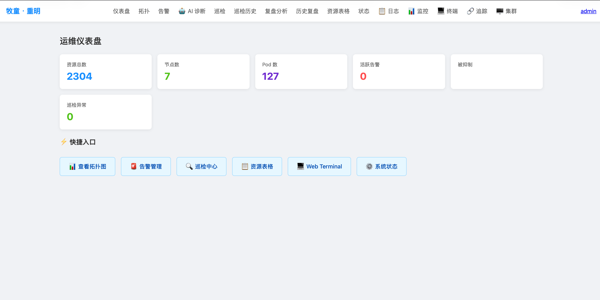
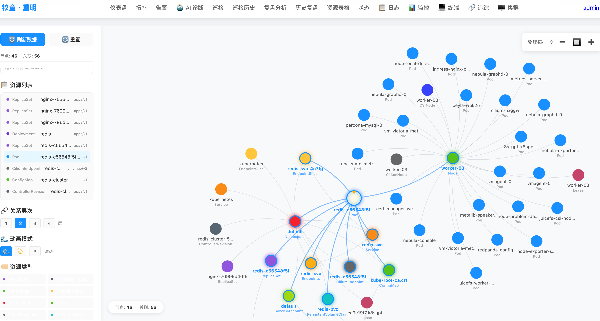
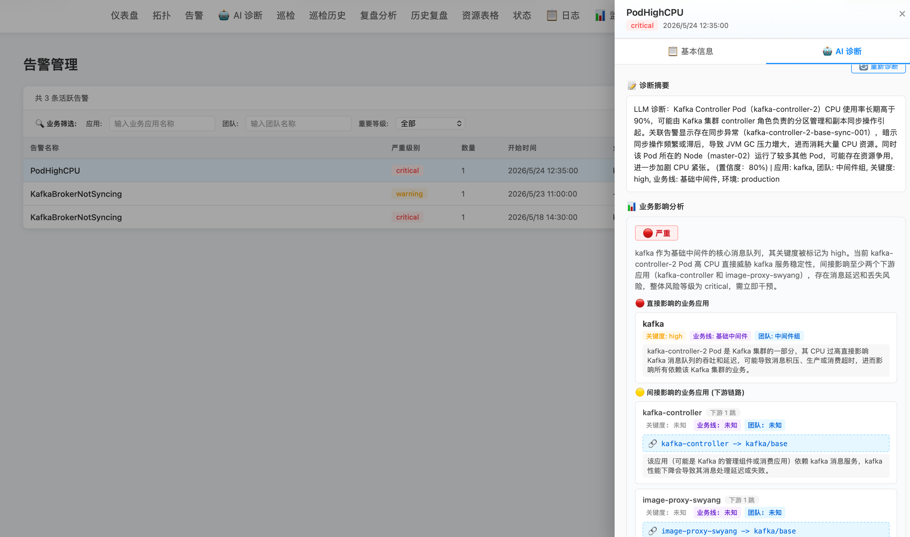
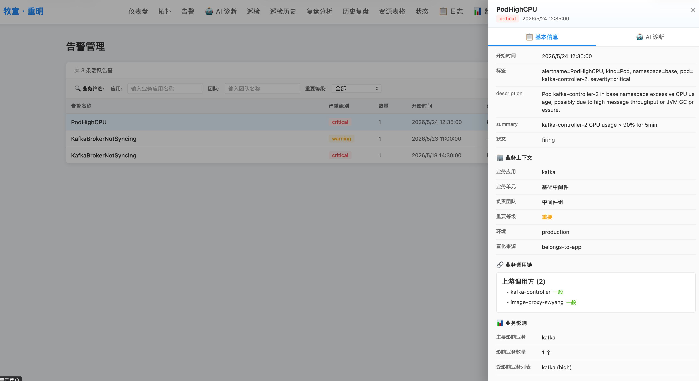
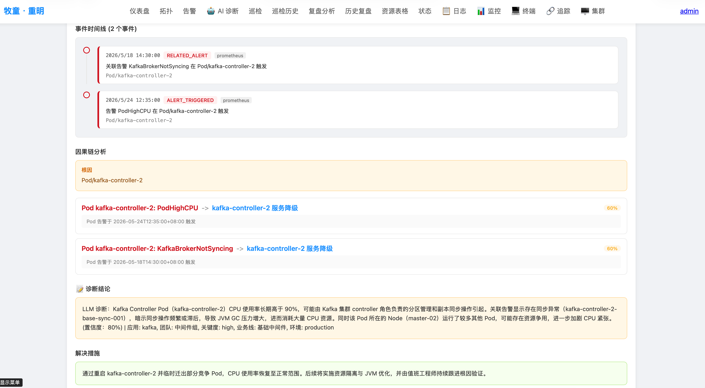

# 重明 (Mutong)

> 📦 **开源仓库**
> - **GitHub**: [https://github.com/tddh/mutong](https://github.com/tddh/mutong)
> - **Gitee**:  [https://gitee.com/tddh/mutong](https://gitee.com/tddh/mutong)

## 项目概述

**重明 (Mutong)** 是一款面向 Kubernetes 集群的资源可视化与智能运维（AIOps）平台。它自动采集 K8s 集群中的各类资源，以图数据库构建完整的资源拓扑关系，提供交互式拓扑可视化、告警智能收敛与诊断、声明式巡检、自愈执行、事后复盘分析等一站式运维能力。

平台以 **"看见、理解、修复、沉淀"** 为设计理念，从资源可视化出发，经由混合 AI 诊断引擎定位根因、自动执行修复操作，最终将每一次故障的结构化复盘沉淀为可检索的知识资产，形成运维闭环。

### 名字出处

> **离，丽也。日月丽乎天，百谷草木丽乎土，重明以丽乎正，乃化成天下。** ——《易经·离卦·彖传》

### 核心价值

- **资源可视化**: 以 Nebula Graph 图数据库存储 K8s 资源拓扑关系，支持复杂关系查询和 G6 / force-graph / d3 三种渲染引擎的交互式拓扑图展示，多维度筛选过滤
- **告警收敛与智能诊断**: 基于拓扑感知的告警抑制与因果链抑制，消除告警风暴；混合 AI 诊断引擎（规则快速路径 + LLM 深度分析），自动降级，多维度置信度评估
- **声明式巡检**: YAML 声明式巡检规则，内置 3 类检查类型（min_rows / field_contains / command），Cron 定时调度，支持历史报告对比与趋势分析
- **自愈执行器**: 风险分级（Low / Medium / High）的自动修复操作（Pod 驱逐重启/删除、Deployment 扩缩容/回滚、镜像与资源调整等），支持手动审批与自动执行双模式；执行后后台自动验证就绪状态、可回滚动作验证失败自动恢复变更，完整审计日志
- **复盘知识沉淀**: 事件时间线 + 因果链 DAG + LLM 复盘报告 + 图增强混合检索（pgvector 语义 + NebulaGraph 拓扑），将每次故障转化为可检索、可复用的结构化知识资产

### 💡 为什么做这个项目 / Evolution

Mutong 的演进映射了 Kubernetes 运维的三个阶段，每一步都是为了解决实际痛点：

| 阶段              | 核心痛点                     | 解决方案                                      |
| :-------------- | :----------------------- | :---------------------------------------- |
| **🟢 2022 可视化** | 资源关系"看不见"，故障影响面不明确       | **图数据库 (NebulaGraph)**：构建 K8s 资源拓扑，定位级联影响 |
| **🟡 2023 自动化** | 看着图还要切终端敲命令太累了（其实也不会写前端） | **API-First 策略**：把操作变成接口，交给 CLI 调用        |
| **🔴 2025 智能化** | 复杂根因难定位，专家经验难传承          | **LLM Agent 混合诊断**：规则兜底 + AI 深度排查的知识闭环    |

> 所有功能均源自真实场景的反复打磨。详见完整 [演进故事 →](docs/evolution.md)

### 界面预览

| 仪表盘 | 拓扑图 | AI 诊断 |
|:---:|:---:|:---:|
|  |  |  |
| *资源概览与集群统计* | *K8s 资源拓扑可视化* | *LLM 智能诊断交互* |

| 告警管理 | 巡检报告 | 复盘分析 |
|:---:|:---:|:---:|
|  |  |  |
| *告警列表与抑制状态* | *巡检结果与历史对比* | *因果链 DAG 与影响评估* |

## 功能特性

### 1. 资源采集与存储

- **多资源类型**: Pod、Service、Deployment、ConfigMap、Node、StatefulSet、DaemonSet、Ingress、PVC 等 K8s 原生资源，以及通过 Beyla eBPF + OTel Collector 自动发现的应用服务
- **图数据库**: Nebula Graph 存储资源拓扑关系（节点 + 边），支持 nGQL 查询与注入防护
- **关系型数据库**: PostgreSQL + pgvector（GORM 驱动，连接池 100），存储用户、角色、审计日志、诊断结果、复盘报告及向量化故障知识
- **消息队列**: Kafka（franz-go 客户端），异步消息处理，支持死信队列与指数退避重试
- **会话缓存**: Redis（go-redis/v9），诊断会话缓存与会话级结果存储
- **内存缓存**: BigCache（v3），分片高性能缓存，可配置最大容量与清理策略
- **标签过滤**: 支持按标签排除特定资源（如 `app.kubernetes.io/managed-by: Helm`）

### 2. 资源关系分析与可视化

- **拓扑关系构建**: 自动识别并构建 Pod-Deployment、Service-Pod、Node-Pod、Ingress-Service 等多维关联关系
- **复杂查询搜索**: 支持基于 nGQL 的资源搜索和多层级关系查询
- **Web 拓扑图展示**: 三引擎渲染——@antv/g6（2D 交互拓扑）、force-graph（3D 力导向图）、d3（自定义 SVG 布局）
- **多维度筛选**: 按命名空间、资源类型、标签、名称模糊匹配等条件组合过滤

### 3. 告警收敛与智能诊断

- **拓扑感知抑制**: 基于资源拓扑关系，同一作用域内自动抑制衍生告警
- **因果链抑制**: 识别告警间因果关系（如 Kafka 故障自动抑制上游 Consumer 超时），消除告警风暴
- **声明式抑制规则**: YAML 配置声明式抑制规则，按拓扑作用域（same_node / calls_app_upstream / same_owner）精准抑制
- **Owner / Stakeholder 双维度路由**: 中间件告警同时通知负责方（PagerDuty）与所有受影响业务方（Slack）
- **混合 AI 诊断引擎**:
  - 多维度自动置信度评分：规则诊断分 + 关联告警 + 业务关键度，分够直接返回结果
  - LLM 深度分析：基于 Eino ADK Runner（cloudwego/eino）ReAct Agent，全量注册 MCP 工具（29 个，含执行类自愈提议工具），LLM 按需选择调用
  - 容错机制：SafeTool middleware 工具失败不中断、ModelRetryConfig 自动重试（3 次指数退避）
  - 全流程 SSE 流式输出（`text/event-stream`），前端增量渲染 + 工具调用浮动面板 + 分层超时
  - 自动降级：LLM 不可用时无缝降级到纯规则诊断
  - 诊断结果持久化：根因、业务影响、调用链、指标快照、日志片段、拓扑快照存入 PostgreSQL，支持后续复盘复用
- **三层影响评估**: 简单计数 / 分层影响 / 业务影响，自动关联受影响的服务与 Ingress
- **拓扑快照**: 诊断时抓取告警关联资源的实时拓扑（节点 + 边），为 AI 提供结构化上下文

### 4. 巡检系统

- **声明式 YAML 规则**: 每条规则由 query（nGQL） + check（判断条件） + severity + suggestion 组成
- **3 类内置检查类型**:
  | 类型 | 说明 |
  |------|------|
  | `min_rows` | 检查查询结果行数是否达到阈值（如确保副本数 ≥ 2） |
  | `field_contains` | 检查字段值是否包含指定子串（如证书 CN 是否包含预期域名） |
  | `command` | 外部插件，stdin / stdout JSON 接口，任意语言编写自定义检查 |
- **6 类内置规则**: 证书过期检查、单点故障检测、数据孤岛识别、资源配额监控、监控盲点扫描、镜像审计
- **定时执行**: Cron 表达式调度 + 手动触发
- **报告对比与趋势**: 历史报告对比、趋势分析、Pass / Fail / Warn 统计

### 5. 自愈执行器

- **支持操作**（13 类，API 参数使用 snake_case，枚举定义见 `models/executor/executor.go`）:
  - `restart_pod`: Pod 优雅重启（先尝试 Eviction API，失败后 fallback 到 Delete）
  - `delete_pod`: 删除 Pod（由 Deployment/StatefulSet/DaemonSet 控制器自动重建）
  - `scale_deployment`: Deployment 副本扩缩容（有 maxReplicas 上限保护）
  - `rollout_restart`: 滚动重启 Deployment（改写 pod template 注解触发，等价 `kubectl rollout restart`）
  - `create_hpa`: 创建 HPA（Horizontal Pod Autoscaler）
  - `update_hpa`: 更新已有 HPA 配置
  - `update_configmap`: 更新 ConfigMap 数据
  - `update_secret`: 更新 Secret 数据
  - `update_resource_limits`: 调整容器 CPU/Memory 资源限制（支持 cpu_limit/memory_limit/cpu_request/memory_request）
  - `update_deployment_image`: 变更容器镜像
  - `rollout_undo`: 回滚 Deployment 到历史版本（等价 `kubectl rollout undo`，基于 ReplicaSet revision 历史；支持指定 revision，0 = 上一版本）
  - `update_annotations`: 修改资源注解（当前仅支持 Deployment）
  - `update_labels`: 修改资源标签（当前仅支持 Deployment）
- **风险等级**: Low / Medium / High 三级
- **执行模式**: 手动审批模式（默认）/ 自动模式（基于风险阈值配置）
- **执行后验证**: 执行成功后后台异步轮询 Deployment rollout 完成度 / 新 Pod Ready 状态（最长 4 分钟，每次轮询独立超时），结果回写审计记录并在前端展示验证徽标（验证通过 / 失败已回滚 / 失败需人工 / 验证中）
- **失败自动回滚**: 改镜像 / 调资源等可回滚动作验证失败时，自动恢复"最近已知健康版本"（knownGood，无则回退变更前模板快照），防止"自愈"变"自伤"；其余动作验证失败标记待人工介入
- **审计日志**: 操作人、时间、目标资源、操作类型、执行结果、风险等级完整写入 PostgreSQL

### 6. 复盘分析

- **事件时间线**: 基于告警指纹构建完整时间线，含 MTTD（Mean Time To Detect）延迟标注
- **因果链分析**: 自动推断告警间因果关系，DAG 图可视化展示故障传播路径
- **LLM 复盘报告**: AI 生成结构化复盘报告，包含经验教训、改进项、解决措施；支持 WhatWentWell / WhatWentWrong / ContributingFactors 三段式反思
- **诊断缓存复用**: 复用诊断阶段的根因、业务影响、调用链、指标快照、日志片段、拓扑快照
- **业务拓扑图**: G6 渲染业务调用链拓扑，故障业务（红色）→ 上游调用方（橙色）→ 下游依赖方（蓝色），支持全屏模式
- **影响评估**: 爆炸半径 + 三层分层影响表格（直接影响 / 间接影响 / 业务服务影响）
- **指标快照**: CSS 条形图展示诊断时的 Prometheus 指标（CPU / 内存 / 网络 / 重启次数），支持 resourceProfiles 自定义 PromQL
- **关键日志**: 可折叠 ES 日志卡片，ERROR（红色）/ WARN（橙色）/ INFO（蓝色）级别颜色区分
- **改进项看板**: Prevent / Detect / Mitigate 三列看板，每项含 ExitCriteria + Owner + DueDate
- **图增强混合检索**: pgvector 向量语义 + NebulaGraph 拓扑结构双路检索，融合排序，自动发现同 Deployment / 同 Node 的历史相似故障
- **复盘-资源双向关联**: 通过资源 UID 查询关联的所有历史复盘，从资源视角回溯故障历史
- **历史复盘页**: 独立列表页（筛选 + 详情查看 + 编辑修正 + Markdown 导出），fingerprint 重复生成自动覆盖（UPSERT）

### 7. 日志与指标

- **Elasticsearch 日志查询**: Pod 日志检索、关键词搜索、按 Error / Warn / Info 级别筛选
- **Prometheus 指标查询**: Pod / Node / Deployment 级别指标，阈值判断，HPA 状态查询，时序数据查询
- **BigCache 缓存**: 分片高性能内存缓存，缓存 ES 日志与 Prometheus 指标查询结果

### 8. Web 终端

- **WebSocket K8s 终端**: 基于 WebSocket 的 Kubernetes 容器终端会话
- **多容器切换**: Pod 内多容器自由切换
- **会话管理**: 独立会话生命周期管理，连接关闭时回收 K8s exec 流与 goroutine
- **自适应大小**: 终端 resize 事件自动同步
- **命名空间准入**: 默认拒绝系统命名空间（`kube-system` / `kube-public` / `kube-node-lease`），其余允许；`terminal.allowedNamespaces` 配置项与 `SetAllowedNamespaces` 注入接口已就绪，但 `cmd/main.go` 尚未接线，配置该项当前不改变行为（见 [架构文档「已知实现缺口」](docs/PROJECT_ARCHITECTURE.md)）。会话建立 / 拒绝与 exec 起止产生审计事件，当前写服务端日志（审计表注入同样待接线）
- **前端本地打包**: xterm.js 及其 addon 由 Vite 本地打包，不再依赖 CDN

### 9. 链路追踪

- **OpenTelemetry 集成**: 完整分布式追踪支持
- **SkyWalking 兼容**: 支持 SkyWalking OAP 作为后端存储
- **服务依赖分析**: 可视化服务间调用关系

### 10. MCP 工具服务器

实现 Model Context Protocol (MCP)，提供 22 个诊断工具 + 7 个执行类工具（自愈提议），共 29 个工具供 LLM 通过 Function Calling 自动调用。AI 诊断全量注册所有工具（不再按场景过滤），LLM 根据 prompt 指引按需选择。每次工具调用自动记录日志，支持调试追踪。

| 工具名 | 功能描述 |
|--------|----------|
| `query_topology` | 查询某资源的拓扑关联（最多 2 跳，含上下游依赖、服务关联及 ownerReferences 归属链；支持任意内置/CRD Kind，可上溯到 operator/CRD 根因） |
| `get_active_alerts` | 获取当前活跃告警列表 |
| `get_alert_detail` | 获取指定告警的详细信息 |
| `run_diagnosis` | 执行 AI 诊断流程 |
| `inspect_resource` | 检查指定 K8s 资源实时状态 |
| `get_inspection_report` | 获取最新巡检报告 |
| `list_resources_from_graph` | 从 NebulaGraph 列出指定类型资源 |
| `list_k8s_resources` | 从 K8s API 实时查询资源清单（内置资源走 typed client；任意 CRD 走 watch 同步的 informer，group/version 由 discovery 自动解析） |
| `list_resources_from_cache` | 从本地 Informer 缓存查询资源（内置资源 + 任意 CRD，秒级新鲜度，不超时；CRD 的 group/version/复数名由 discovery 自动解析） |
| `get_resource_metrics` | 获取资源 Prometheus 指标快照 |
| `query_metric_timeseries` | 查询指标时序数据 |
| `get_system_health` | 获取系统各组件健康状态 |
| `get_metric_catalog` | 获取可用 Prometheus 指标目录 |
| `get_pod_logs` | 获取 Pod 日志（K8s API） |
| `get_pod_logs_es` | 获取 Pod 日志（Elasticsearch） |
| `search_logs` | 日志关键词全文搜索（ES） |
| `get_error_logs` | 获取 Error 级别日志（ES） |
| `search_similar_cases` | 向量相似度搜索历史故障案例 |
| `search_knowledge_base` | 搜索互联网获取实时技术信息（Tavily，返回 AI 摘要+文章链接） |
| `search_github_issues` | 搜索 GitHub Issues 查找已知 Bug 和修复方案 |
| `list_alerts` | 简化版活跃告警列表 |
| `generate_retrospective` | 生成故障复盘报告（条件启用） |

**执行类工具（自愈提议，强制携带告警指纹，无诊断支撑的调用直接拒绝；同指纹待审批提议去重）**：

| 工具名 | 分组 | 功能描述 |
|--------|------|----------|
| `restart_pod_safe` | 安全组（自动门禁） | 安全重启 Pod（先 Eviction 优雅驱逐，失败 fallback Delete） |
| `rollout_restart` | 安全组（自动门禁） | 滚动重启 Deployment（template 注解触发） |
| `scale_deployment` | 安全组（自动门禁） | Deployment 副本扩缩容（maxReplicas 上限保护） |
| `update_deployment_image` | 提案组（强制人工审批） | 提议变更容器镜像（执行后验证，失败自动回滚） |
| `adjust_resource_limits` | 提案组（强制人工审批） | 提议调整 CPU/内存 requests/limits（执行后验证，失败自动回滚） |
| `delete_pod` | 提案组（强制人工审批） | 提议删除 Pod 由控制器重建（仅限有控制器管理的 Pod） |
| `rollout_undo` | 提案组（强制人工审批） | 提议回滚 Deployment 到历史版本（ReplicaSet revision，支持指定版本） |

> 安全组工具调用后进入既有门禁（自动模式 + 诊断置信度阈值）；提案组工具只生成待审批提议，**任何情况下都不自动执行**，必须人工在执行记录中批准后才生效。

### 11. RBAC 权限

- **三种角色**:
  - `admin`: 完整权限（read / write / execute / admin）
  - `operator`: 读 + 执行权限（不可修改系统配置）
  - `viewer`: 只读权限
- **仪表盘级权限**: 不同角色对应不同默认仪表盘视图
- **认证中间件**: BearerTokenMiddleware（支持 Bearer token + session cookie 双模式）+ RequireAuthMiddleware（白名单放行 login/webhook/external，其余 /api/ 需认证）

### 12. 业务拓扑

- **自动发现**: Beyla eBPF 自动采集应用间 HTTP / gRPC 调用关系 → OTel Collector 接收 → Kafka 传输 → 后端消费并构建业务归属
- **调用拓扑**: 自动构建应用间调用拓扑图，支持 G6 交互式渲染
- **业务标签同步**: 从 K8s 标签自动提取业务归属信息（应用名、业务线、Owner 等）
- **K8s 资源关联**: 将业务应用映射到具体 K8s 工作负载（Deployment / StatefulSet / DaemonSet），打通业务视角与基础设施视角

### 13. CLI 工具 (mutongctl)

`mutongctl` 是重明平台的命令行工具，提供与 Web UI 对等的运维能力，适用于 CI/CD 流水线集成、自动化脚本和值班快速排查。

- **资源查询**: `get` / `list` 查询 K8s 资源详情与列表（Pod / Node / Deployment 等 6 种资源）
- **拓扑查询**: `topo` 查询资源拓扑关系（节点 + 边），支持深度搜索
- **告警管理**: `alert list` / `alert get` 查看活跃告警与详情
- **AI 诊断**: `diagnose run` 一键触发 LLM 诊断，`diagnose status` 查看诊断服务状态
- **巡检管理**: `inspect run` 触发巡检、`inspect report` / `list` / `compare` / `trend` 查看报告
- **复盘分析**: `retro generate` / `list` / `get` / `export` / `search` 故障复盘全流程
- **日志与指标**: `logs` / `metrics` 查询日志和 Prometheus 指标
- **系统管理**: `cluster` / `system` / `stats` / `exec` 集群状态与执行器管理
- **业务拓扑**: `biz` 查询业务应用与调用关系
- **外部搜索**: `search github` / `search tavily` 搜索 GitHub Issues 和互联网知识库
- **配置管理**: `config` 多环境（context）切换，支持 flag > env > 配置文件认证链
- **认证登录**: `auth login` 浏览器 OAuth2 授权码流程（PKCE），自动保存 token
- **智能输出**: 四种输出格式（table / json / yaml / markdown），TTY 自适应，管道友好
- **Shell 补全**: `completion` 支持 bash / zsh / fish 动态补全
- **Agent 集成**: 通过 OpenCode Skill 供 AI Agent 自动调用，覆盖资源查询、告警诊断、巡检复盘等全平台操作

详细用法见 [mutongctl 使用手册](docs/mutongctl-usage.md)。

```bash
# 快速示例
mutongctl auth login                              # 浏览器授权码登录
mutongctl alert list --severity critical          # 查看 Critical 告警
mutongctl diagnose run --fingerprint <fp>         # 一键 AI 诊断
mutongctl logs pod nginx -n production --tail 50  # 查看 Pod 日志
mutongctl inspect run && mutongctl inspect report # 执行巡检并查看报告
mutongctl search github -q "OOMKilled" -r "kubernetes/kubernetes"  # 搜索 GitHub Issues
mutongctl search tavily -q "Pod CrashLoopBackOff 排查"              # 搜索互联网知识
mutongctl config set server https://mutong.example.com  # 配置服务地址
```

## 技术栈

| 组件 | 技术 | 说明 |
|------|------|------|
| 后端语言 | Go | 1.27 |
| Web 框架 | Gin | v1.10，路由聚合注册 |
| 图数据库 | NebulaGraph | v3 客户端，存储资源拓扑 |
| 关系数据库 | PostgreSQL + pgvector | GORM 驱动，向量语义 + 结构化混合检索 |
| 消息队列 | Kafka（franz-go） | 死信队列 + 指数退避重试 |
| 缓存 | BigCache（v3） + Redis（go-redis/v9） | 内存缓存 + 会话缓存 |
| 日志 | Zap + Lumberjack | 结构化日志 + 自动轮转 |
| 监控 | Prometheus + gops | 指标暴露 + Go 运行时诊断 |
| 链路追踪 | OpenTelemetry + SkyWalking | 分布式追踪 |
| AI 框架 | Eino（cloudwego/eino） | ReAct Agent + Function Calling |
| LLM | MiniMax M2.5 / OpenAI / Claude | 可配置，规则降级 |
| eBPF | Beyla（Grafana） | 应用调用关系自动采集 |
| 性能分析 | Pyroscope | 持续性能分析 |
| 前端 | Vue 3 + Vite | 多页面 SPA |
| 图形可视化 | @antv/g6 + force-graph + d3 | 拓扑图 / DAG / 力导向图 |
| 包管理 | Bun | 前端依赖管理 |
| CLI 框架 | Cobra + Viper | 命令路由、配置管理、Shell 补全 |
| 构建 | Just（Justfile） | 多平台交叉编译 |

## 项目结构

```
mutong/
├── cmd/                         # 应用入口
│   ├── main.go                  #   Web 服务入口（装配 + 路由 + 中间件）
│   ├── mutongctl/               #   CLI 工具 (20 个命令模块)
│   ├── mergebizapp/             #   一次性维护命令：合并重复 BusinessApp 顶点（支持 -dry-run）
│   └── resetadmin/              #   管理员账号重置工具
├── config/                      # 配置加载（viper + 结构体定义）
├── configs/                     # 拆分配置（含 .example 模板）
│   ├── config.core.yaml.example  #   核心配置（数据库、缓存、日志）
│   ├── config.alert.yaml.example #   告警系统配置
│   ├── config.diagnosis.yaml.example # AI 诊断配置
│   ├── config.inspection.yaml.example # 巡检开关 + Cron
│   ├── config.infra.yaml.example #   基础设施（ES/OTel/Executor）
│   ├── config.business.yaml.example # 业务拓扑配置
│   ├── config.profiles.yaml.example # 资源画像（拆分为 profiles/ 目录）
│   ├── config.auth.yaml.example   #   认证授权配置
│   ├── config.retrospective.yaml.example # 复盘自动触发配置
│   ├── profiles/                  #   资源画像独立文件（按资源类型）
│   │   ├── pod.yml node.yml deployment.yml service.yml
│   │   ├── statefulset.yml daemonset.yml pvc.yml ingress.yml
│   ├── rules/inspection/          #   巡检规则独立文件（按规则）
│   │   ├── cert_expiry.yml single_point_failure.yml
│   │   ├── cmdb_data_silo.yml monitoring_blindspot.yml
│   │   ├── resource_quota.yml image_audit.yml
│   └── prompts/                 #   LLM Prompt 模板
├── controllers/                 # 控制器层（34 个 Go 文件：31 实现 + 3 测试，含 oauth2/ 子包）
├── services/                    # 服务层
│   ├── alert/                   #   告警管道: enricher → suppressor → router → notifier
│   ├── diagnosis/               #   AI 诊断引擎（含混合检索模块）
│   ├── retrospective/           #   复盘分析服务
│   ├── inspection/              #   巡检服务
│   ├── executor/                #   K8s 自愈执行器
│   ├── mcp/                     #   MCP 工具服务器
│   ├── logsearch/               #   ES 日志查询
│   ├── prometheus/              #   Prometheus 指标查询
│   ├── terminal/                #   WebSocket 终端
│   ├── trace/                   #   OTel 追踪查询
│   ├── audit/                   #   审计日志
│   ├── auth/                    #   认证授权（OAuth2/Casbin/密码）
│   ├── prompt/                  #   Prompt 模板管理
│   ├── k8sresource_*.go         #   K8s 资源核心服务
│   ├── getResource.go           #   资源获取接口
│   ├── query_builder.go         #   nGQL 查询构建器
│   ├── ngql_sanitizer.go        #   nGQL 注入防护
│   ├── resource_cache.go        #   资源缓存
│   ├── business_label_syncer.go  #   业务标签同步 (Kafka 消费)
│   ├── business_topology_service.go  # 业务拓扑查询服务
│   ├── trace_topology_syncer.go  #   链路拓扑同步 (SkyWalking)
│   ├── namespace_mapper.go       #   命名空间-业务映射
│   ├── user_service.go           #   用户服务
│   └── role_service.go           #   角色服务
├── models/                      # 数据模型（按模块分包：alert/audit/diagnosis/executor/inspection/oauth2/retrospective）
├── interfaces/                  # 接口定义（依赖反转）
├── pkg/                         # 可复用基础库
│   ├── ngql/                    #   nGQL 字符串字面量 sanitizer（注入防护）
│   └── safe/                    #   goroutine 安全封装（recover + 堆栈）
├── view/                        # 前端代码 (Vue 3 + Vite)
│   └── src/                     #   15 个功能页面 + 2 个认证页面 + 共享组件
├── docs/                        # 项目文档
│   ├── PROJECT_ARCHITECTURE.md   # 分层架构、目录职责与关键流程
│   ├── evolution.md              # 项目演进手记与设计思考（英文版 evolution.en.md）
│   ├── mutongctl-usage.md        # CLI 工具速查与使用手册
│   ├── ngql.md                   # NebulaGraph Schema 参考与查询示例
│   ├── TODO.md                   # 待办事项与竞品差距分析
│   ├── remediation-plan.md       # 安全与发布工程修复规划
│   └── images/                   # 界面预览截图
├── scripts/                     # 脚本工具
│   ├── schema.ngql               #   NebulaGraph DDL（just init-nebula 执行）
│   ├── init_postgres.sh          #   PostgreSQL 初始化
│   ├── update_nebula.sh          #   NebulaGraph 更新脚本
│   ├── init_es_template.sh       #   Elasticsearch 索引模板初始化
│   └── smoke_test.sh             #   冒烟测试
├── deploy/                      # 部署配置 (Beyla + OTel Collector Helm charts 及 values、entrypoint.sh)
├── artifacts/                   # 构建产物输出目录
├── agent.yaml.example           # SkyWalking 代理配置模板
├── Justfile                     # 构建命令
├── Dockerfile                   # 多阶段构建（非 root 运行，HEALTHCHECK /healthz）
├── docker-compose.yml           # 本地一键起依赖 + 应用
├── ROADMAP.md                   # 版本路线图
├── CONTRIBUTING.md              # 贡献指南
├── SECURITY.md                  # 安全政策与漏洞报告流程
├── go.mod                       # Go 模块定义（go 1.27.0）
└── LICENSE                      # MIT 许可证
```

分层职责与关键流程详见 [项目架构文档](docs/PROJECT_ARCHITECTURE.md)。

## 配置说明

配置统一使用 `configs/` 目录下的拆分配置文件，程序启动时通过 `-c configs/` 目录模式加载。

每个配置文件都提供 `.example` 模板，**首次使用需复制为实际配置文件**：

```bash
for f in configs/*.yaml.example; do cp "$f" "${f%.example}"; done
cp agent.yaml.example agent.yaml
```

### 核心配置（config.core.yaml）

```yaml
kubernetes:
  clusters:
    - name: "cluster1"
      config: kubeconfig

postgres:
  host: localhost
  port: 5432
  user: mutong
  pass: "your-password"
  database: mutong
  pool: 100

nebula:
  host: "localhost"
  port: 9669
  user: "root"
  pass: "nebula"
  space: "mutong"

cache:
  lifeTime: 40
  cleanWindow: 10
  enable: true
  hardMaxCacheSize: 4096
  shards: 256

log:
  level: info
  path: logs
  max_size: 100
  max_age: 30

server:
  address: "0.0.0.0"
  port: 8888
  sseWriteTimeoutSec: 300  # SSE 写超时，诊断对话等长连接场景
```

### 告警配置（config.alert.yaml）

```yaml
alert:
  routing:
    defaultReceiver: "default"
    defaultChannel: "slack"
  notifier:
    slackWebhookUrl: ""
    emailConfig: {}
  suppressor:
    timeWindowSeconds: 300
    maxDepth: 3
  cleanup:
    cleanupInterval: 1
    retentionDuration: 4320  # 半年

# 外部告警源注册（Ceph/Kafka/MySQL 等任意系统接入）
# labelMapping 将外部标签映射到内部标准格式
# enrichmentStrategy 选择桥接策略: node_affinity / service_graph / direct_business_app / business_labels / none
alertSources:
  sources:
    - name: "ceph-prod"
      type: "ceph"
      enrichmentStrategy: "node_affinity"
      labelMapping:
        alertname: "alert_name"
        node: "host"
      businessMapping:
        team: "storage-team"
```

### 诊断配置（config.diagnosis.yaml）

```yaml
diagnosis:
  enabled: true
  confidenceThreshold: 0.8
  cacheTTL: 3600
  llm:
    provider: "openai"    # none / openai / claude / custom
    model: "gpt-4"
    apiKey: ""            # 通过 MUTONG_LLM_API_KEY 环境变量设置
    baseURL: "https://api.openai.com"
    timeout: 120
    maxTokens: 16384      # 单次 LLM 调用的最大输出 token 数
    embedding:
      model: "text-embedding-3-small"
      baseURL: "https://api.openai.com"
  session:
    enabled: true
    redis: "localhost:6379"
    password: ""         # 生产环境务必设置，通过 MUTONG_REDIS_PASSWORD 环境变量
    db: 9
    ttl: 1800            # Redis 会话 TTL（秒），PG 保留 30 天自动清理

# 外部知识库搜索
external_search:
  enabled: true
  auditEnabled: true
  tavily:
    apiKey: ""  # 通过环境变量 MUTONG_TAVILY_KEY 设置
    timeoutSeconds: 15
    maxResults: 3
  github:
    token: ""  # 通过环境变量 MUTONG_GITHUB_TOKEN 设置（可选，无 Token 限制 60 次/小时）
    timeoutSeconds: 10
    maxResults: 3
```

### 自愈执行器配置（config.infra.yaml）

```yaml
executor:
  enabled: false
  autoMode: false
  auditLog:
    type: postgres
    table: executor_audit_logs
  actions:
    restart_pod:
      risk: low
      autoThreshold: 0.7
    scale_deployment:
      risk: medium
      autoThreshold: 0.85
    delete_pod:
      risk: high
      autoThreshold: 1.0
    rollout_restart:
      risk: low
      autoThreshold: 0.7
    rollout_undo:
      risk: high
      autoThreshold: 1.0
    create_hpa:
      risk: medium
      autoThreshold: 0.9
    update_hpa:
      risk: medium
      autoThreshold: 0.85
    update_configmap:
      risk: medium
      autoThreshold: 0.9
    update_secret:
      risk: high
      autoThreshold: 0.95
    update_resource_limits:
      risk: medium
      autoThreshold: 0.85
    update_deployment_image:
      risk: high
      autoThreshold: 0.9
    update_annotations:
      risk: low
      autoThreshold: 0.7
    update_labels:
      risk: low
      autoThreshold: 0.7
```

### 环境变量

以下环境变量可覆盖配置文件对应字段（读取位置见 `cmd/main.go`、`config/config.go`）：

| 环境变量 | 说明 | 默认值 |
|----------|------|--------|
| `MUTONG_ADDR` | HTTP 服务监听地址，覆盖 `server.address` | 取配置文件（0.0.0.0） |
| `MUTONG_PORT` | HTTP 服务端口，覆盖 `server.port` | 取配置文件（8888） |
| `MUTONG_MAX_PROCS` | GOMAXPROCS | CPU 核数 |
| `MUTONG_ALLOWED_ORIGINS` | CORS 允许域名，逗号分隔；`*` 被忽略 | 空（拒绝跨域） |
| `MUTONG_DB_USER` | PostgreSQL 用户名 | - |
| `MUTONG_DB_PASSWORD` | PostgreSQL 密码 | - |
| `MUTONG_NEBULA_USER` | Nebula 用户名 | - |
| `MUTONG_NEBULA_PASS` | Nebula 密码 | - |
| `MUTONG_LLM_API_KEY` | LLM API Key | - |
| `MUTONG_EMBEDDING_API_KEY` | Embedding API Key（不设置时复用 LLM Key） | - |
| `MUTONG_REDIS_ADDR` | Redis 地址 | - |
| `MUTONG_REDIS_PASSWORD` | Redis 密码 | - |
| `MUTONG_REDIS_DB` | Redis 数据库编号 | - |
| `MUTONG_TAVILY_KEY` | Tavily 外部搜索 API Key | - |
| `MUTONG_GITHUB_TOKEN` | GitHub Issues 搜索 Token（可选） | - |
| `MUTONG_INIT_ADMIN_PASSWORD` | 首次启动创建 `admin` 账号的密码；账号已存在时不重置 | 不设置则不创建管理员 |
| `MUTONG_ISSUER_URL` | OAuth2 / OIDC 发行者 URL | - |

安全相关环境变量（`MUTONG_SESSION_SECRET`、`MUTONG_ADMIN_KEY`、`MUTONG_WEBHOOK_SECRET`、`MUTONG_TRUSTED_PROXIES` 等）见下方 [安全配置](#安全配置)。

## 安装与运行

### 前置条件

#### 必需组件（缺失将导致进程无法启动）

| 组件 | 版本 | 用途 | 安装 |
|------|------|------|------|
| Go | 1.27 | 后端编译运行（`go.mod` 声明 `go 1.27.0`） | [go.dev/dl](https://go.dev/dl/) |
| Bun | 1.x+ | 前端包管理 | [bun.sh](https://bun.sh/) |
| NebulaGraph | 3.8+ | 图数据库 — 存储 K8s 资源拓扑关系 | [nebula-graph.io](https://www.nebula-graph.io/download) |
| Kafka（或 Redpanda） | Kafka 2.x+ / Redpanda v24+ | 消息队列 — K8s 资源变更事件异步传输 | [kafka.apache.org](https://kafka.apache.org/downloads) |
| BigCache | 内嵌，自动初始化 | 内存缓存 — 高性能分片缓存 | — |

> ⚠️ **NebulaGraph 和 Kafka 是硬依赖**，连接失败会导致进程退出。缺少 PostgreSQL 时服务可以降级启动，但大部分持久化功能不可用（见下方降级说明）。

#### 可选组件（按需启用，缺失时对应功能自动降级）

| 组件 | 版本 | 用途 | 未安装时的行为 |
|------|------|------|---------------|
| PostgreSQL | 15+（含 pgvector） | 关系数据 & 向量检索 | ⚠️ 降级为内存存储：用户/角色/告警统计/诊断结果/复盘报告不持久化，向量语义搜索不可用 |
| Kubernetes 集群 | — | 资源采集 & 自愈执行 | ⚠️ K8s 相关功能（拓扑可视化、终端、自愈）不可用，平台仍可处理告警和诊断 |
| Redis | 7+ | 诊断会话缓存 & 登录限流 | ⚠️ 诊断会话降级为内存模式（重启丢失），登录限流不可用 |
| Prometheus | 2.x+ | 指标查询（CPU/内存/网络/重启次数） | ⚠️ 指标查询 API 返回 503，诊断结果不含指标快照 |
| Elasticsearch | 8.x+ | 日志检索 | ⚠️ ES 日志查询不可用，K8s API 直查日志仍可用 |
| LLM API Key | — | AI 诊断深度分析 & 复盘报告生成 | ⚠️ 诊断自动降级为纯规则路径（规则引擎 + 拓扑分析），仍可给出置信度评分 |
| Beyla + OTel Collector | Beyla 2.x+ | eBPF 自动发现服务调用关系 → 业务拓扑 | ⚠️ 业务拓扑和调用关系图不可用 |
| SkyWalking OAP | 9.x+ | 链路追踪后端 | ⚠️ 分布式追踪查询不可用 |
| Pyroscope | — | 持续性能分析 | ⚠️ 性能火焰图不可用 |

> 💡 **最小化启动**：仅需 NebulaGraph + Kafka + Go/Bun 即可编译运行。在 `configs/config.core.yaml` 中配置这两个组件即可启动进程。其他组件按需逐步添加，每添加一个即启用一类功能。

### 快速开始

```bash
# 1. 克隆项目
git clone https://gitee.com/tddh/mutong.git
cd mutong

# 2. 初始化配置（从 .example 模板复制）
for f in configs/*.yaml.example; do cp "$f" "${f%.example}"; done
cp agent.yaml.example agent.yaml
# 编辑 configs/*.yaml 中的数据库连接、K8s 集群等配置

# 3. 注入密钥（生产必做，详见「安全配置」章节）
export MUTONG_SESSION_SECRET="$(openssl rand -hex 32)"
export MUTONG_WEBHOOK_SECRET="$(openssl rand -hex 32)"
export MUTONG_INIT_ADMIN_PASSWORD='<强密码>'

# 4. 初始化数据库
just init-nebula
# 执行 scripts/init_postgres.sh 初始化 PostgreSQL 表结构

# 5. 编译运行
just build-mac       # 产出 darwin 二进制（macOS 本地开发）
just run             # 按当前平台自动选择 artifacts/ 下的二进制，以 -c configs/ 启动

# 调试模式
just run-debug
```

> `just run` / `just run-debug` / `just run-config` 按宿主机平台自动选择 `artifacts/mutong-<os>-<arch>`。macOS (Apple Silicon) 用 `just build-mac`，Linux x86_64 用 `just build`，其他平台用 `just build-host` 产出对应二进制。`just build` 只做编译与配置同步，不再内嵌 `go mod tidy` / `gofmt`；依赖整理与格式化请显式执行 `just tidy` 与 `just fmt`。

### Docker 部署

> **前置条件**：Docker Engine 20.10+ 和 Docker Compose v2+

根目录 `docker-compose.yml` 的数据库口令全部改为必填变量，未设置时 `docker compose` 直接报错而不是使用弱口令：

```bash
export POSTGRES_PASSWORD='<数据库密码>'
export NEBULA_PASSWORD='<Nebula 密码>'
export MUTONG_REDIS_PASSWORD='<Redis 密码>'
# 应用侧安全密钥（见「安全配置」章节）
export MUTONG_SESSION_SECRET="$(openssl rand -hex 32)"
export MUTONG_WEBHOOK_SECRET="$(openssl rand -hex 32)"

docker compose up -d
```

一键启动以下服务（使用 Redpanda 替代 Apache Kafka，兼容 Kafka 协议）：

| 服务 | 镜像 | 用途 |
|------|------|------|
| PostgreSQL 16 + pgvector | `pgvector/pgvector:pg16` | 关系数据 & 向量检索 |
| NebulaGraph metad | `vesoft/nebula-metad:v3.8.0` | 图数据库元数据服务 |
| NebulaGraph storaged | `vesoft/nebula-storaged:v3.8.0` | 图数据库存储服务 |
| NebulaGraph graphd | `vesoft/nebula-graphd:v3.8.0` | 图数据库查询服务（9669） |
| Redpanda (Kafka 兼容) | `vectorized/redpanda:v24.2.5` | 消息队列（9092） |
| Redis | `redis:7-alpine` | 会话缓存（6379） |
| Mutong | 本地构建 | 主应用（8888） |

NebulaGraph 三个组件缺一不可：只起 graphd 而没有 metad/storaged 时无法创建 space，`just init-nebula` 会失败。各服务端口映射到宿主机，便于本地调试；生产环境请按需收敛暴露面。

详见 `docker-compose.yml`。注意：部署到生产环境前请修改各服务默认密码，并确认镜像内只包含 `*.example` 配置模板（见 `.dockerignore`）。

### 部署业务拓扑组件

业务拓扑功能需要额外部署 Beyla (eBPF) + OTel Collector，用于自动采集服务间调用关系。

**数据流**：`Beyla (eBPF采集) → OTel Collector (OTLP接收) → Kafka (mutong_trace_01) → Mutong (TraceTopologySyncer + BusinessLabelSyncer)`

```bash
# 在线安装
helm repo add grafana https://grafana.github.io/helm-charts
helm repo add open-telemetry https://open-telemetry.github.io/opentelemetry-helm-charts
helm repo update
helm install beyla grafana/beyla -n beyla --create-namespace -f deploy/helm-beyla-values.yaml
helm install otel-collector open-telemetry/opentelemetry-collector -n otel-collector --create-namespace -f deploy/helm-otelcol-values.yaml

# 验证
kubectl get pods -n beyla
kubectl get pods -n otel-collector
kubectl logs -n otel-collector -l app.kubernetes.io/name=opentelemetry-collector --tail=50
```

离线环境：`helm pull` 下载 Chart → 传输 `.tgz` 和 `deploy/` 下 values 文件 → `helm install` 本地安装。

### 前端开发

```bash
cd view && bun install    # 安装依赖
just dev-ui               # 开发模式（热重载）
just build-ui             # 生产构建
```

Vite 开发代理配置（`just dev-ui` 自动生效）：

| 代理路径 | 目标 |
|----------|------|
| `/api/*` | `http://localhost:8888` |
| `/k8s/*` | `http://localhost:8888` |
| `/metrics/*` | `http://localhost:8888` |

## API 概览

### K8s 资源 API

| 方法 | 路径 | 功能 |
|------|------|------|
| GET | `/api/v1/k8s/resources/{name}` | 获取指定资源详情 |
| GET | `/api/v1/k8s/resources/graph/nodes` | 获取所有资源节点 |
| GET | `/api/v1/k8s/resources/graph/edges` | 获取所有资源关系 |
| GET | `/api/v1/k8s/resources/graph/metadata` | 获取资源类型与命名空间元数据 |
| GET | `/api/v1/k8s/resources/graph/search` | 搜索资源关系 |
| GET | `/api/v1/k8s/resources/graph/resource-define` | 获取资源类型定义 |
| GET | `/api/v1/k8s/resources/graph/suggest` | 资源搜索自动补全建议 |

### 告警管理 API

| 方法 | 路径 | 功能 |
|------|------|------|
| POST | `/api/v1/alerts/webhook` | 接收 Alertmanager Webhook（K8s 告警） |
| POST | `/api/v1/alerts/external/:source` | 接收外部系统告警（Ceph/Kafka/MySQL 等） |
| GET | `/api/v1/alerts` | 获取活跃告警列表 |
| GET | `/api/v1/alerts/{fingerprint}` | 获取告警详情 |
| GET | `/api/v1/alerts/health` | 告警服务健康检查 |
| GET | `/api/v1/alerts/suppression/status` | 获取当前抑制状态 |
| GET | `/api/v1/alerts/sources` | 列出所有注册的外部告警源 |

### AI 诊断 API

| 方法 | 路径 | 功能 |
|------|------|------|
| POST | `/api/v1/diagnosis/run` | 执行 AI 诊断 |
| POST | `/api/v1/diagnosis/rerun` | 重新执行诊断 |
| GET | `/api/v1/diagnosis/result/{id}` | 获取诊断结果 |
| GET | `/api/v1/diagnosis/status` | 诊断服务状态 |
| GET | `/api/v1/diagnosis/tools` | 列出所有 MCP 工具 |
| POST | `/api/v1/diagnosis/mcp/tool/{name}` | 执行指定 MCP 工具 |
| POST | `/api/v1/diagnosis/chat/ask` | AI 诊断问答（SSE 流式，自动创建会话历史） |
| POST | `/api/v1/diagnosis/chat/context` | 建立诊断上下文 |
| GET | `/api/v1/diagnosis/chat/sessions` | 当前用户会话历史列表 |
| GET | `/api/v1/diagnosis/chat/sessions/{id}` | 加载指定会话详情 |
| DELETE | `/api/v1/diagnosis/chat/sessions/{id}` | 删除指定会话 |
| GET | `/api/v1/diagnosis/chat/session/by-alert` | 按告警指纹查询会话 |
| DELETE | `/api/v1/diagnosis/chat/{sessionId}` | 关闭会话 |

### 巡检服务 API

| 方法 | 路径 | 功能 |
|------|------|------|
| POST | `/api/v1/inspection/execute` | 手动触发巡检 |
| GET | `/api/v1/inspection/report` | 获取最新巡检报告 |
| GET | `/api/v1/inspection/reports` | 历史报告列表 |
| GET | `/api/v1/inspection/reports/{id}` | 指定报告详情 |
| GET | `/api/v1/inspection/reports/{id}/compare/{other_id}` | 对比两份报告 |
| GET | `/api/v1/inspection/trend` | 巡检趋势数据 |
| GET | `/api/v1/inspection/rules` | 自定义规则列表 |
| POST | `/api/v1/inspection/rules` | 创建自定义巡检规则 |
| PUT | `/api/v1/inspection/rules/{id}` | 更新巡检规则 |
| DELETE | `/api/v1/inspection/rules/{id}` | 删除巡检规则 |
| POST | `/api/v1/inspection/rules/{id}/toggle` | 启停巡检规则 |

### 自愈执行器 API

| 方法 | 路径 | 功能 |
|------|------|------|
| GET | `/api/v1/executor/status` | 执行器状态 |
| GET | `/api/v1/executor/audit` | 审计日志列表 |
| POST | `/api/v1/executor/execute` | 执行自愈操作 |
| POST | `/api/v1/executor/toggle` | 切换自动 / 手动模式 |
| POST | `/api/v1/executor/diagnose-and-execute` | 诊断并自动执行 |
| POST | `/api/v1/executor/audit/{id}/approve` | 批准待审批的执行计划并立即执行（需 admin 门禁） |

### 日志查询 API

| 方法 | 路径 | 功能 |
|------|------|------|
| GET | `/api/v1/logs/pod` | 获取 Pod 日志（ES） |
| GET | `/api/v1/logs/search` | 日志关键词搜索 |
| GET | `/api/v1/logs/errors` | 获取 Error 级别日志 |
| GET | `/api/v1/logs/warn` | 获取 Warn 级别日志 |
| GET | `/api/v1/logs/info` | 获取 Info 级别日志 |

### 指标与监控 API

| 方法 | 路径 | 功能 |
|------|------|------|
| GET | `/api/v1/metrics/pod` | Pod 指标 |
| GET | `/api/v1/metrics/node` | Node 指标 |
| GET | `/api/v1/metrics/deployment` | Deployment 指标 |
| GET | `/api/v1/metrics/statefulset` | StatefulSet 指标 |
| GET | `/api/v1/metrics/daemonset` | DaemonSet 指标 |
| GET | `/api/v1/metrics/service` | Service 指标 |
| GET | `/api/v1/monitoring/metrics/{resourceType}` | 资源类型指标 |
| GET | `/api/v1/monitoring/timeseries` | 指标时序数据 |
| GET | `/api/v1/monitoring/health` | 系统健康状态 |
| GET | `/api/v1/monitoring/catalog` | 可用指标目录 |

### 复盘分析 API

| 方法 | 路径 | 功能 |
|------|------|------|
| GET | `/api/v1/retrospective/timeline/{fingerprint}` | 事件时间线 |
| GET | `/api/v1/retrospective/causal-chain/{fingerprint}` | 因果链分析 |
| POST | `/api/v1/retrospective/postmortem/{fingerprint}` | 生成复盘报告 |
| PUT | `/api/v1/retrospective/postmortem/{fingerprint}` | 人工修正报告 |
| GET | `/api/v1/retrospective/postmortem/{fingerprint}/text` | 导出 Markdown |
| GET | `/api/v1/retrospective/list` | 历史报告分页列表 |
| GET | `/api/v1/retrospective/history/{fingerprint}` | 历史报告详情 |
| GET | `/api/v1/retrospective/knowledge/search` | 图增强混合检索故障知识 |
| GET | `/api/v1/retrospective/resource/{resourceUID}/postmortems` | 按资源查历史复盘 |

### 用户与角色管理 API

| 方法 | 路径 | 功能 |
|------|------|------|
| GET | `/api/v1/users` | 获取用户信息 |
| GET | `/api/v1/roles` | 获取角色信息 |

### 认证授权 API

| 方法 | 路径 | 功能 |
|------|------|------|
| POST | `/api/auth/login` | 用户登录（密码） |
| GET | `/api/auth/me` | 获取当前登录用户信息 |
| POST | `/api/auth/logout` | 用户登出 |
| POST | `/api/auth/tokens` | 创建 API Token（PAT） |
| GET | `/api/auth/tokens` | 列出当前用户的 API Token |
| DELETE | `/api/auth/tokens/:id` | 撤销指定 API Token |

### OAuth2 / OIDC API

| 方法 | 路径 | 功能 |
|------|------|------|
| GET/POST | `/oauth2/authorize` | OAuth2 授权端点 |
| POST | `/oauth2/token` | OAuth2 Token 端点（Authorization Code + PKCE、Refresh Token、Client Credentials、Device Code；别名 `POST /oauth/v2/token`） |
| POST | `/oauth2/introspect` | Token 内省端点 |
| POST | `/oauth2/revoke` | Token 撤销端点 |
| POST | `/oauth2/device/auth` | 设备授权请求（RFC 8628；别名 `POST /oauth/v2/device_authorization`），返回 `device_code` / 8 位 `user_code` / `verification_uri`，有效期 600s、轮询间隔 5s |
| GET/POST | `/device` | 设备授权确认页面（需先登录；批准把授权绑定到批准用户） |
| GET | `/.well-known/openid-configuration` | OIDC Discovery 元数据 |

> **设备流换 token 的当前行为**：客户端以 `grant_type=urn:ietf:params:oauth:grant-type:device_code` 轮询 `/oauth2/token`，`client_id` 必须与发起授权时一致，device code 单次原子消费（`authorized → completed`）。成功后**签发真实持久化 PAT**（`mtp_` 前缀，绑定批准用户与授权 scope，有效期 1 天 / `expires_in=86400`），走与其他 token 完全相同的校验与撤销路径，**不返回 `refresh_token`**。`verification_uri` 取自 `MUTONG_ISSUER_URL`，不取请求 Origin 头。

### 其他 API

| 方法 | 路径 | 功能 |
|------|------|------|
| GET | `/api/v1/clusters` | 集群列表 |
| GET | `/api/v1/clusters/{name}/health` | 集群健康检查 |
| GET | `/api/v1/clusters/{name}/stats` | 获取集群统计信息 |
| GET | `/api/v1/stats/overview` | 资源概览统计 |
| GET | `/api/v1/stats/resource-total` | 获取资源总数统计 |
| POST | `/api/v1/stats/sync` | 手动同步资源 |
| GET | `/api/v1/terminal/ws` | WebSocket 终端连接 |
| GET | `/api/v1/terminal/namespaces` | 列出命名空间 |
| GET | `/api/v1/terminal/pods` | 列出 Pod |
| GET | `/api/v1/terminal/containers` | 列出容器 |
| GET | `/api/v1/trace/query` | 查询 Trace |
| GET | `/api/v1/trace/services` | 服务列表 |
| GET | `/api/v1/trace/spans` | 获取 Span 详情 |
| GET | `/api/v1/business-topology/apps` | 业务应用列表 |
| GET | `/api/v1/business-topology/graph` | 业务拓扑图数据 |
| GET | `/api/v1/business-topology/calls` | 获取应用间调用关系 |
| GET | `/api/v1/system/status` | 系统整体状态 |
| GET | `/healthz` | 无鉴权存活探针，返回 `200 ok`（K8s / Docker 健康检查用） |
| GET | `/metrics` | Prometheus 指标端点（默认需鉴权，`MUTONG_METRICS_PUBLIC=true` 放行） |

## 前端页面

共 15 个功能页面，均支持响应式布局，顶部配备统一的粘性 **NavBar 导航栏**。导航为**数据驱动**，单一真源是 `view/src/components/nav.config.js`：

- **`NAV_ITEMS`（12 个可见入口）**：8 个主入口 + 4 个收进「更多」菜单的次级入口（1280px 宽度下全平铺会溢出）
  > 主入口：仪表盘 | 拓扑 | 告警 | AI 诊断 | 巡检 | 状态 | 终端 | 集群
  > 更多：巡检历史 | 复盘分析 | 历史复盘 | 资源表格
- **`NAV_HIDDEN`（3 个已收起入口）**：日志 / 监控 / 追踪。**页面代码完整保留**，每项带收起原因与代码位置；恢复只需把该项移回 `NAV_ITEMS` 并指定 `group`，无需改模板。
  | 入口 | 收起原因 |
  |------|----------|
  | 日志 | 依赖 Elasticsearch，测试环境 `localhost:9200` 无监听；客户端不探测连通性，路由仍在但查询必失败 |
  | 监控 | 页面过于粗糙，待重建为 Grafana 内嵌（方案见 `docs/TODO.md`） |
  | 追踪 | `config.infra.yaml` 中 `opentelemetry.enabled=false`，TraceController 未挂载 |

> 早期版本靠在 NavBar 模板里包注释块来隐藏入口，注释在开发模式保留、生产构建被丢弃，行为不一致；改为数据驱动后隐藏项显式落在 `NAV_HIDDEN`，不再依赖注释语义。

除上述 15 个功能页面外，项目还包含 2 个认证相关页面：`login.html`（平台登录）和 `consent.html`（OAuth 授权确认），它们不使用全局 NavBar 导航栏。

下表列出全部 15 个功能页面（含 3 个当前无菜单入口的页面）：

| 页面 | 入口文件 | 功能 |
|------|----------|------|
| 仪表盘 | `view/src/index.html` | StatCards 6 项核心指标（资源总数/节点数/Pod数/活跃告警/被抑制告警/巡检异常）+ 快速链接；接口失败显示错误态，不再回落假数据 |
| 拓扑图 | `view/src/topology/index.html` | force-graph 力导向图，物理/业务双视图，左侧边栏筛选，右侧详情面板（指标徽章/关联资源） |
| 资源列表 | `view/src/resource-table.html` | 表格分页（500条/页），按 Kind 着色，支持关键词搜索（300ms 防抖）+ Terminal 跳转 |
| 告警管理 | `view/src/alerts/index.html` | 聚合告警展开/折叠，按业务应用/团队/关键度筛选，右侧抽屉双选项卡（基本信息 + AI 诊断） |
| AI 诊断 | `view/src/diagnosis/index.html` | 对话式 Markdown 流式渲染（30ms 增量缓冲），工具调用浮动面板（pulse 动画 + 自动消失），侧栏会话历史管理 + LLM 摘要标题，新建/续接/删除会话，分层超时（总 300s / 首 token 15s / 空闲 60s），流中断可重试 |
| 巡检报告 | `view/src/inspection/index.html` | 手动触发巡检，表格展示各规则检查结果（级别/规则/资源/建议），6 类内置规则 |
| 巡检历史 | `view/src/inspection-history/index.html` | 历史报告筛选、详情查看、报告对比、趋势分析（7/14/30/60/90 天） |
| 复盘分析 | `view/src/retrospective/index.html` | 输入指纹生成复盘：事件时间线 + 因果 DAG + 业务拓扑 + 影响评估 + 指标快照 + 关键日志 + 改进项看板 |
| 复盘历史 | `view/src/retrospective-history/index.html` | 历史报告筛选、详情查看、人工编辑修正（UPSERT）、Markdown 导出 |
| 日志查询 | `view/src/logs/index.html` | ES 日志检索，7 个筛选器（namespace/pod/container/level/keyword/since/tail），按级别着色（菜单已收起） |
| 监控面板 | `view/src/monitoring/index.html` | 左侧资源选择器 → 右侧指标卡片网格（CPU/内存/网络/重启），8 类 Prometheus 指标（菜单已收起） |
| Web 终端 | `view/src/terminal/index.html` | xterm.js 5.5，5 步连接流程，自适应 resize，URL 参数预填充 |
| 链路追踪 | `view/src/trace/index.html` | SkyWalking，按服务/操作/TraceID 查询，Span 瀑布图展示（菜单已收起） |
| 集群管理 | `view/src/clusters/index.html` | 集群列表 + 健康检查 + 统计弹窗，30s 自动刷新 |
| 系统状态 | `view/src/status/index.html` | 5 张状态卡片（LLM/抑制/处理指标/诊断统计/自愈执行器），30s 自动刷新 |

## 构建命令

使用 `just` 管理构建流程：

| 命令 | 说明 |
|------|------|
| `just build` | 编译 Linux amd64 + macOS arm64 二进制（不改写 go.mod / 不做格式化） |
| `just build-host` | 仅编译宿主机平台二进制（`just run` 使用的产物） |
| `just build-mac` | 仅编译 macOS arm64（本地开发） |
| `just build-skywalking` | 带 SkyWalking 代理编译（Linux amd64 + arm64） |
| `just run` | 运行宿主机平台产物（`-c configs/` 目录模式） |
| `just run-debug` | 调试模式运行（log-level=debug） |
| `just run-config <file>` | 指定配置文件运行 |
| `just dev-ui` | 前端开发模式（热重载） |
| `just build-ui` | 构建前端（输出到 artifacts/view） |
| `just preview-ui` | 前端预览 |
| `just test` | 运行所有单元测试（-race） |
| `just test-cover` | 运行测试并生成覆盖率报告 |
| `just test-module <module>` | 运行指定模块测试 |
| `just test-alert` | 运行告警系统 API 测试 |
| `just test-ui` | 前端测试（vitest） |
| `just bench` | 基准测试 |
| `just smoke-test` | 运行动态冒烟测试 |
| `just init-nebula` | 初始化 Nebula Graph 空间与 Schema |
| `just update-nebula` | 更新 nGQL 语句 |
| `just init-es-template` | 初始化 Elasticsearch 索引模板 |
| `just clean` | 清理构建产物 |
| `just fmt` | 格式化 Go 代码（gofmt） |
| `just tidy` | 整理依赖（go mod tidy，独立于 build） |
| `just lint` | 静态代码检查（go vet） |
| `just swagger` | 生成 Swagger API 文档 |
| `just all` | 一键流程：fmt + test + build |
| `just full-build` | 后端 + 前端完整构建 |
| `just build-cli` | 编译 mutongctl（linux amd64 + darwin arm64）并同步 OpenCode Skill |
| `just build-cli-mac` | 仅编译 macOS arm64 版 mutongctl |
| `just test-cli` | 运行 CLI 单元测试 |
| `just all-cli` | CLI 测试 + 构建 |
| `just run-js` | 运行 JavaScript 测试文件 |

## 开发指南

### 添加新的资源关系类型

1. 在 `scripts/schema.ngql` 中添加新边类型 DDL，同步更新 `docs/ngql.md` 的 Schema 概览表
2. 执行 `just init-nebula` 应用 Schema 变更
3. 在 `services/k8sresource_relationships.go` 中实现关系识别逻辑
4. 更新 `services/query_builder.go` 中的 nGQL 查询构建器
5. 在 `controllers/k8sresource_controller.go` 中添加对应 API 端点
6. 前端 `view/src/topology/` 中更新图例和渲染配置

### 添加新的巡检规则

无需修改 Go 代码——在 `configs/rules/inspection/` 下新建 `<rule_name>.yml` 文件即可：

```yaml
name: "check-pod-restarts"
description: "检查 Pod 重启次数"
query: |
  MATCH (p:K8sResource{kind:'Pod', is_deleted:false})
  RETURN p.K8sResource.name AS name, p.K8sResource.name_space AS namespace
check:
  type: min_rows
  threshold: 3
severity: "warning"
suggestion: "Pod 频繁重启，请检查资源限制与应用日志"
```

若内置 check type 无法满足，编写 command 插件脚本（stdin 接收 JSON 参数，stdout 输出 JSON 结果），放置到 `/etc/mutong/plugins/` 目录。

### 代码风格

- **格式化**: `gofmt -w .`
- **命名**: 驼峰命名法（CamelCase），导出函数首字母大写
- **注释**: 所有导出函数、类型、常量必须添加文档注释
- **错误处理**: 显式处理所有 error，使用 `zap` 记录结构化日志
- **静态检查**: `just lint`（go vet）通过后方可提交

## 常见问题

### 启动与连接

**Q: 启动失败，报错 `cannot connect to NebulaGraph`**  
检查 NebulaGraph 服务是否运行（`nebula-console -addr localhost -port 9669 -u root -p nebula`），确认 `configs/config.core.yaml` 中 `nebula.host` 和 `nebula.port` 配置正确。

**Q: 拓扑页面无数据**  
检查 Kafka 是否正常运行，确认 `configs/config.infra.yaml` 中 Kafka broker 和 topic 配置正确。Informer 首次同步需要 1-2 分钟。

**Q: 集群状态显示"未知"**  
检查 kubeconfig 文件路径是否正确，确认 `configs/config.core.yaml` 中的 `kubernetes.config` 指向有效的 kubeconfig。

### AI 诊断

**Q: AI 诊断不可用，提示 LLM 未连接**  
检查 `configs/config.diagnosis.yaml` 中 LLM 配置：确认 `provider` 不为 `none`、`apiKey` 已设置、`baseURL` 可访问。推荐通过 `MUTONG_LLM_API_KEY` 环境变量设置密钥。

**Q: 诊断回答过于简短或中断**  
检查 `configs/config.diagnosis.yaml` 中 `maxTokens` 配置。DeepSeek API 的有效范围为 `[1, 393216]`，建议设为 `16384` 或更高。若响应末尾提示"响应中断"，检查网络稳定性或调大前端空闲超时。

**Q: 语义搜索（混合检索）不生效**  
检查 `configs/config.diagnosis.yaml` 中 `embedding.model` 已配置，确认 embedding API 端点返回 `/v1/embeddings`。不配置 embedding 时，图结构搜索路径仍可正常工作。

### 日志与指标

**Q: Prometheus 指标无数据**  
检查 `configs/config.infra.yaml` 中 `prometheus.enabled` 为 `true`，确认 `prometheus.url` 可访问。

**Q: 日志查询返回空**  
检查 `configs/config.infra.yaml` 中 Elasticsearch 配置：`elasticsearch.addresses` 和 `elasticsearch.indexPattern` 是否正确，确认 ES 中存在对应索引。

### Web 终端

**Q: Web 终端连接失败**  
确认目标 Pod 处于 Running 状态，容器内存在 `/bin/sh` 或所选的 Shell。检查 RBAC 权限是否允许 exec 操作。

### 性能优化

**Q: 系统响应缓慢**  
调整 `configs/config.core.yaml` 中 BigCache 的 `hardMaxCacheSize`（建议 4096 MB）和 `shards`（建议 256）。定期执行 Nebula 清理（`nebulaCleanup.enabled: true`，`retentionDays: 7`）。PostgreSQL 连接池建议保持 `pool: 100`。

## 安全

平台按「默认拒绝 + 服务端权威 + 全程审计」三条原则设计，主要控制如下（均可在代码中核对）：

### 认证与授权

- **默认拒绝鉴权**：`RequireAuthMiddleware` 不再按 `/api/` 前缀推断，除精确白名单（登录、验证码、OIDC 回调、告警入口、OAuth2 协议端点、`/view/` 静态资源、`/healthz`）外一律要求已验证身份（`controllers/auth_middleware.go`）。
- **四种身份来源**：PAT/SAT（`mtp_`/`mts_` 前缀，SHA-256 哈希查库）、OIDC access token、本地 OAuth2 access token（fosite 内省）、会话 Cookie。Cookie 只接受 HMAC 验签通过的 token，**不存在「cookie 值即 UUID」的回退分支**。
- **密码与会话**：Argon2id 密码哈希；OAuth2 / OIDC 授权码流程带 PKCE；会话 Cookie 显式 `SameSite=Lax` + `HttpOnly`，`Secure` 依据 TLS / `X-Forwarded-Proto` / `MUTONG_COOKIE_SECURE`；登录接口带 IP 限流与验证码。
- **Casbin RBAC**：`admin` / `operator` / `viewer` 三角色，策略按用户 UUID 绑定，登录时同步角色。终端 WebSocket、执行器、MCP 工具调用即使使用 GET 也按 `execute` 动作鉴权（`controllers/casbin_middleware.go`）。支持 `enforce` / `shadow` / `off` 三种模式。
- **危险操作二次门禁**：执行器写操作与审批额外校验 `X-Admin-Key`；未配置 `MUTONG_ADMIN_KEY` 时回退为要求 `admin` 角色，密钥比较使用常量时间算法。

### 数据与输入

- **凭据存储**：PAT/SAT 只存 SHA-256 哈希，不可逆；敏感配置一律支持环境变量覆盖。
- **注入防护**：nGQL 字符串字面量统一经 `pkg/ngql` sanitizer 处理；PromQL 标签值转义后再拼接。
- **敏感数据脱敏**：Secret 的 `data` / `stringData` 在资源详情与图谱接口返回前删除（`services/getResource.go`）。
- **XSS 防护**：`/device` 页面 `html.EscapeString`；诊断 Markdown 经 `marked.parse` 后由 DOMPurify 清洗。
- **外部搜索脱敏**：出站查询先经 PII 脱敏 + 搜索词提取 + 高 PII 阻断，入站结果做 prompt injection 过滤，调用元数据写审计（`services/diagnosis/sanitizer.go`、`services/mcp/search_tools.go`）。

### 告警入口

- **Webhook 签名**：`/api/v1/alerts/webhook` 强制 HMAC-SHA256 签名 + 时间戳窗口（±300s）+ 重放拒绝，body 上限 1MB。详见 [安全配置](#安全配置)。
- **外部告警源**：`/api/v1/alerts/external/:source` 需要 `X-Alert-Token`，或来源 IP 命中 `MUTONG_WEBHOOK_TRUSTED_IPS`；两者都未配置时直接拒绝。
- **可信代理**：默认只信任本机回环，避免 `X-Forwarded-For` 伪造。

### 操作与执行

- **风险分级**：13 类自愈操作均带 Low / Medium / High 风险等级与阈值，全量写审计日志。
- **LLM 不可越权**：模型输出的 `risk` / `confidence` 不作为执行依据，`auto_fixable` 恒为 false；MCP 提案组工具只生成待审批记录，**任何情况下都不自动执行**。
- **执行后验证与回滚**：可回滚动作验证失败时自动恢复「最近已知健康版本」，其余标记待人工介入。
- **终端隔离**：namespace 准入默认拒绝系统命名空间（`terminal.allowedNamespaces` 尚未在启动时注入，见上文「Web 终端」）+ 会话审计事件；会话关闭时回收 K8s exec 流与 goroutine。

### 暴露面收敛

- Swagger UI 默认关闭（`server.enableSwagger`）；`/metrics` 默认需要鉴权（`MUTONG_METRICS_PUBLIC=true` 才放行）。
- CORS 默认拒绝跨域，`MUTONG_ALLOWED_ORIGINS` 中的 `*` 被忽略。
- 静态资源只服务构建产物目录（`artifacts/view` 或 `view/dist`），不暴露 `view/` 源码树。
- 容器以非 root 用户 `mutong` 运行，镜像只包含 `*.example` 配置模板。

完整安全政策与漏洞报告流程见 [SECURITY.md](SECURITY.md)。

## 安全配置

生产部署前必须确认下列配置项。变量名与默认值以 `cmd/main.go`、`config/config_base.go`、`controllers/` 现行代码为准。

### 安全相关环境变量

| 环境变量 | 语义 | 未设置时的行为 |
|----------|------|----------------|
| `MUTONG_SESSION_SECRET` | 会话 Cookie 的 HMAC 签名密钥 | 依次回退到 `auth.global_secret` → `MUTONG_SESSION_SECRET_FILE`（默认 `data/session_secret`）中已有的 ≥32 字节密钥 → 自动生成 32 字节密钥并以 0600 持久化。**多副本部署必须显式共享同一密钥**，否则会话只在签发它的副本上有效 |
| `MUTONG_SESSION_SECRET_FILE` | 会话密钥持久化路径 | `data/session_secret` |
| `MUTONG_AUTH_SECRET` | OAuth2 Provider 的签名密钥，**按 base64 标准解码后使用**，解码结果需 ≥32 字节（不足则视为未设置） | 使用随机密钥，**重启后所有已签发 token 失效** |
| `MUTONG_ADMIN_KEY` | 执行器危险操作的 `X-Admin-Key` 共享密钥 | 回退为要求 `admin` 角色（不再无条件放行） |
| `MUTONG_WEBHOOK_SECRET` | 告警 webhook 的 HMAC-SHA256 密钥 | **拒绝所有 webhook**，除非显式设置 `MUTONG_WEBHOOK_ALLOW_UNSIGNED=true` |
| `MUTONG_WEBHOOK_ALLOW_UNSIGNED` | 设为 `true` 时允许未签名 webhook（仅限隔离的测试环境） | 空（不允许） |
| `MUTONG_EXTERNAL_ALERT_TOKEN` | 外部告警源的 `X-Alert-Token` | 回退到 `MUTONG_WEBHOOK_TRUSTED_IPS`；两者都空则拒绝外部告警 |
| `MUTONG_WEBHOOK_TRUSTED_IPS` | 告警入口的来源 IP/CIDR 白名单，逗号分隔 | 空（不做 IP 限制） |
| `MUTONG_TRUSTED_PROXIES` | 可信反向代理 CIDR，决定何时采信 `X-Forwarded-*` | `127.0.0.1/32,::1/128`（只信任本机回环） |
| `MUTONG_ALLOWED_ORIGINS` | CORS 允许域名，逗号分隔 | 空（拒绝跨域）；`*` 被忽略 |
| `MUTONG_COOKIE_SECURE` | 强制会话 Cookie 带 `Secure` | 依据请求 TLS 或 `X-Forwarded-Proto: https` 自动判定 |
| `MUTONG_METRICS_PUBLIC` | 设为 `true` 时 `/metrics` 免鉴权（供 Prometheus 抓取） | 空（`/metrics` 需要鉴权） |
| `MUTONG_RBAC_MODE` | `enforce` / `shadow` / `off`，优先级低于 `auth.rbac_mode` | `enforce` |
| `MUTONG_INIT_ADMIN_PASSWORD` | 首次启动创建 `admin` 的密码 | 不创建管理员账号（启动日志告警） |

> 生成密钥：`openssl rand -hex 32`。所有密钥都应通过环境变量或密钥管理系统注入，不要写进提交到 Git 的 `configs/*.yaml`。

### 安全相关配置项

| 配置键 | 文件 | 默认值 | 说明 |
|--------|------|--------|------|
| `server.enableSwagger` | `config.core.yaml` | `false` | 开启后暴露 `/swagger/*any`，会公开完整 API 面，生产环境建议保持关闭 |
| `server.rateLimitPerSec` | `config.core.yaml` | `100` | 全局限流（每秒请求数） |
| `auth.mode` | `config.auth.yaml` | `local` | `local` / `hybrid` / `zitadel` |
| `auth.global_secret` | `config.auth.yaml` | 空 | 会话密钥的配置来源，优先级低于 `MUTONG_SESSION_SECRET` |
| `auth.rbac_mode` | `config.auth.yaml` | `enforce` | `enforce` 拦截并返回 403；`shadow` 只记录拒绝日志不拦截（灰度用）；`off` 完全跳过 RBAC（应急开关） |
| `executor.enabled` | `config.infra.yaml` | `false` | 自愈执行器总开关 |
| `executor.autoMode` | `config.infra.yaml` | `false` | 自动执行模式；关闭时所有计划进入待审批 |
| `terminal.allowedNamespaces` | `configs/config.*.yaml` 的 `terminal` 段 | 空（拒绝系统命名空间） | Web 终端可访问的 namespace 白名单。**字段与注入接口已实现，但 `cmd/main.go` 未调用注入，当前生效的始终是默认策略** |

### 最小可用部署示例

```bash
# 1. 密钥（写入 .envrc.local 或密钥管理系统，不要提交到 Git）
export MUTONG_SESSION_SECRET="$(openssl rand -hex 32)"
export MUTONG_AUTH_SECRET="$(openssl rand -hex 32)"
export MUTONG_ADMIN_KEY="$(openssl rand -hex 32)"
export MUTONG_WEBHOOK_SECRET="$(openssl rand -hex 32)"
export MUTONG_INIT_ADMIN_PASSWORD='<强密码>'

# 2. 数据面凭据
export MUTONG_DB_USER=mutong
export MUTONG_DB_PASSWORD='<数据库密码>'
export MUTONG_NEBULA_USER=root
export MUTONG_NEBULA_PASS='<Nebula 密码>'

# 3. 跨机反向代理时显式声明可信代理网段（否则只信任本机回环）
export MUTONG_TRUSTED_PROXIES="10.0.0.0/8"
# 前后端分离部署时才需要 CORS
export MUTONG_ALLOWED_ORIGINS="https://mutong.example.com"

# 4. 配置与启动
for f in configs/*.yaml.example; do cp "$f" "${f%.example}"; done
just init-nebula
just build-mac && just run
```

对应的最小配置片段：

```yaml
# configs/config.core.yaml
server:
  address: "0.0.0.0"
  port: 8888
  enableSwagger: false      # 生产保持关闭
  rateLimitPerSec: 100

# configs/config.auth.yaml
auth:
  mode: local
  rbac_mode: enforce        # 灰度期可临时设为 shadow
  global_secret: ""         # 由 MUTONG_SESSION_SECRET 提供

# configs/config.infra.yaml
executor:
  enabled: false            # 确认审批流程后再开启
  autoMode: false           # 保持人工审批
```

### 告警 Webhook 签名方案

`POST /api/v1/alerts/webhook` 由 `WebhookSignatureMiddleware` 保护（`controllers/webhook_verifier.go`）：

| 请求头 | 说明 |
|--------|------|
| `X-Alertmanager-Signature` | 签名值，小写 hex 编码的 HMAC-SHA256 |
| `X-Alertmanager-Timestamp` | Unix 秒级时间戳，与服务端时钟偏差不得超过 **300 秒** |

**签名算法**：`HMAC-SHA256(secret, 时间戳头值 + "\n" + 原始请求 body)`，取 hex 小写。时间戳参与签名，因此抓到的签名无法配一个新时间戳重放。

校验顺序：签名头存在 → 时间戳可解析且在窗口内 → body 不超过 **1MB**（超限返回 413）→ HMAC 常量时间比较 → 签名重放检查（同一签名在窗口内只接受一次）。任一环节失败返回 401。

发送端示例：

```bash
SECRET="$MUTONG_WEBHOOK_SECRET"
BODY='{"alerts":[{"status":"firing","labels":{"alertname":"Test"}}]}'
TS=$(date +%s)
SIG=$(printf '%s\n%s' "$TS" "$BODY" | openssl dgst -sha256 -hmac "$SECRET" -hex | awk '{print $NF}')

curl -X POST http://localhost:8888/api/v1/alerts/webhook \
  -H "Content-Type: application/json" \
  -H "X-Alertmanager-Timestamp: $TS" \
  -H "X-Alertmanager-Signature: $SIG" \
  -d "$BODY"
```

> Alertmanager 原生 webhook 不支持自定义签名头，需要在中间加一层签名代理（或在 Alertmanager 与本服务之间部署一个计算签名的转发器）。隔离测试环境可临时设置 `MUTONG_WEBHOOK_ALLOW_UNSIGNED=true`，生产环境不要这样做。

外部告警源 `POST /api/v1/alerts/external/:source` 走另一条路径：携带 `X-Alert-Token: <MUTONG_EXTERNAL_ALERT_TOKEN>`，或让来源 IP 命中 `MUTONG_WEBHOOK_TRUSTED_IPS`。

### 健康检查端点

`GET /healthz` 是**无鉴权**的存活探针，返回 `200` 与纯文本 `ok`。它在鉴权中间件链之前注册（`cmd/main.go` 的 `registerHealthz`），因此不受默认拒绝策略影响，可直接用于 Kubernetes liveness/readiness 探针与 Docker `HEALTHCHECK`。

该端点只表示进程存活，不探测下游依赖。需要组件级健康状态时使用 `GET /api/v1/monitoring/health`（需鉴权）。

```yaml
livenessProbe:
  httpGet:
    path: /healthz
    port: 8888
  initialDelaySeconds: 20
  periodSeconds: 30
```

## 许可证

本项目采用 [MIT 许可证](LICENSE)。

## 社区与贡献 / Community

| [行为准则](CODE_OF_CONDUCT.md) | [贡献指南](CONTRIBUTING.md) | [开发路线图](docs/TODO.md) | [安全策略](SECURITY.md) |
|---|---|---|---|
| 了解我们的价值观 | 提交代码与 Bug 修复 | 了解下一步开发计划 | 如何安全地报告漏洞 |

## 致谢

感谢以下开源项目：

- [Gin Web Framework](https://github.com/gin-gonic/gin) — Go HTTP Web 框架
- [Nebula Graph](https://github.com/vesoft-inc/nebula) — 开源分布式图数据库
- [Apache Kafka](https://kafka.apache.org/) — 分布式消息队列
- [Eino](https://github.com/cloudwego/eino) — AI Agent 应用框架（字节跳动）
- [Vue.js](https://vuejs.org/) — 渐进式前端框架
- [AntV G6](https://g6.antv.vision/) — 图可视化引擎
- [Apache SkyWalking](https://skywalking.apache.org/) — 应用性能监控
- [Grafana Beyla](https://github.com/grafana/beyla) — eBPF 应用自动观测
- [Prometheus](https://prometheus.io/) — 监控与告警系统
- [Grafana Pyroscope](https://grafana.com/oss/pyroscope/) — 持续性能分析
- [OpenTelemetry](https://opentelemetry.io/) — 可观测性标准框架
